# My DevOps & Cloud Learning Journey

## Day 01 – Day 06

My learning journey from DevOps fundamentals to Linux, AWS, Shell Scripting, Git and GitHub.

---

# Learning Roadmap

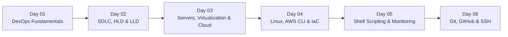

# Day 01 – DevOps Fundamentals

## What is DevOps?

DevOps is a way of working where Development and Operations teams work together to build, test and deploy software faster.

It focuses on automation, collaboration, monitoring and continuous improvement.

### Concepts I Learned

- Development and Operations
- Automation
- Continuous Integration
- Continuous Delivery
- Monitoring
- Reliability
- Feedback
- Continuous Improvement

## DevOps Lifecycle

The DevOps lifecycle explains how software is planned, developed, tested, deployed and maintained.

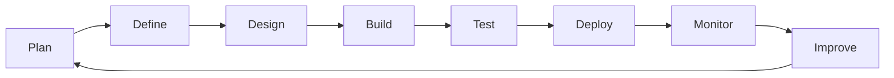

## Development and Operations

Both teams work together to improve the software delivery process.

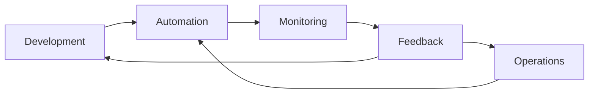

**My takeaway:** DevOps is not just about tools. It is about collaboration, automation and continuous improvement.

---

# Day 02 – SDLC, HLD & LLD

## SDLC – Software Development Life Cycle

SDLC is the process followed to develop and deliver software.

### Stages of SDLC

- Planning
- Requirement Gathering
- Design
- Development
- Testing
- Deployment
- Monitoring
- Feedback

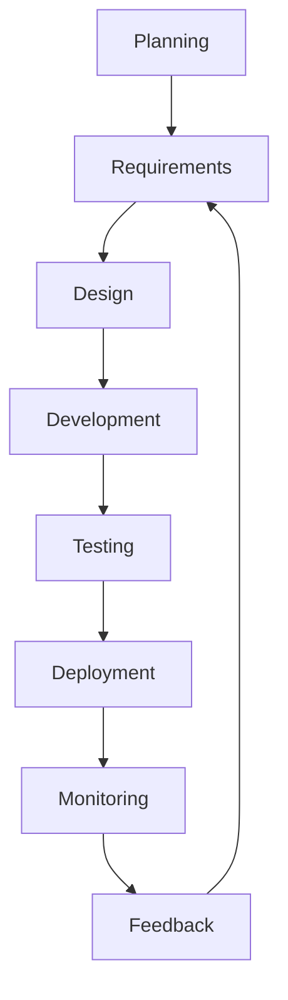

## SRS – Software Requirements Specification

SRS is a document that explains what a software application should do.

### Concepts I Learned

- Understanding user requirements
- Functional requirements
- Defining software features
- Identifying user needs
- Preparing requirements before development

## HLD – High Level Design

HLD explains the overall architecture of a system. It gives us the big picture of how different components work together.

### Concepts I Learned

- System architecture
- Major components
- Services
- Technology choices
- Communication between components

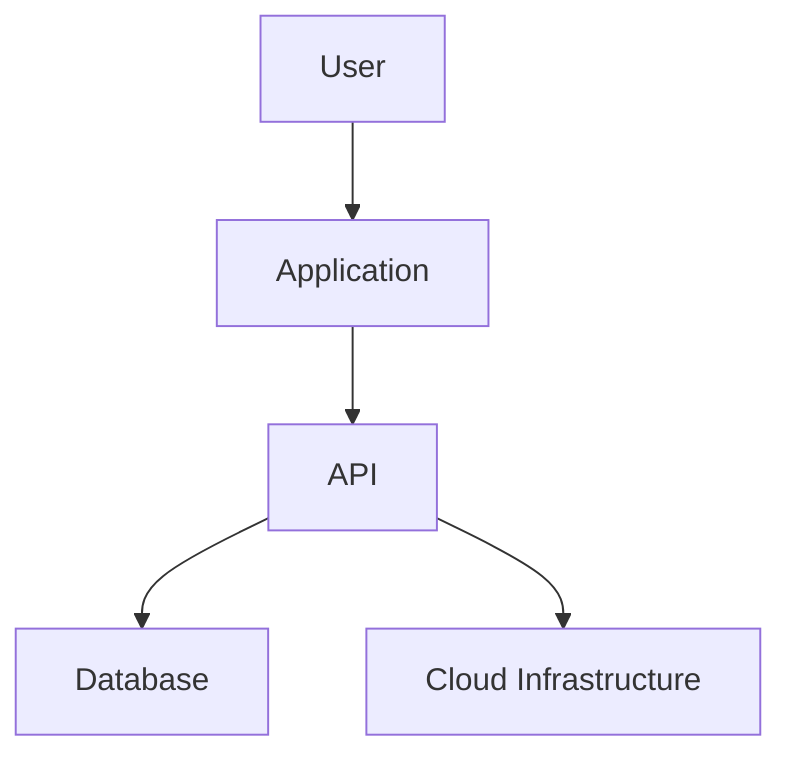

## LLD – Low Level Design

LLD explains how each component is implemented in detail.

### Concepts I Learned

- Classes
- Methods
- Functions
- Internal logic
- Component-level implementation
- Validation

## HLD vs LLD

| HLD | LLD |
|---|---|
| Big picture | Detailed picture |
| System architecture | Implementation details |
| Major components | Classes and methods |
| System level | Component level |
| What components exist | How components work |

**My takeaway:** HLD explains the overall system, while LLD explains how its individual components work.

---

# Day 03 – Servers, Virtualization & Cloud

## What is a Server?

A server is a computer that provides resources or services to other computers.

### Main Server Components

- CPU
- RAM
- Storage
- Network
- Operating System
- Applications

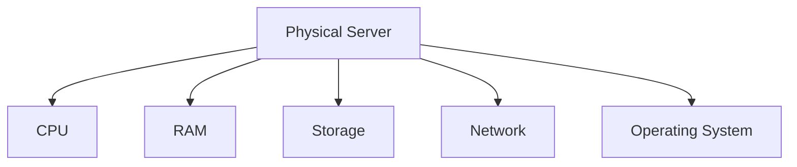

## Virtualization

Virtualization allows multiple virtual machines to run on a single physical server.

### Concepts I Learned

- Virtual Machines
- Hypervisor
- Resource Allocation
- Resource Sharing
- Logical Isolation
- Hardware Utilization

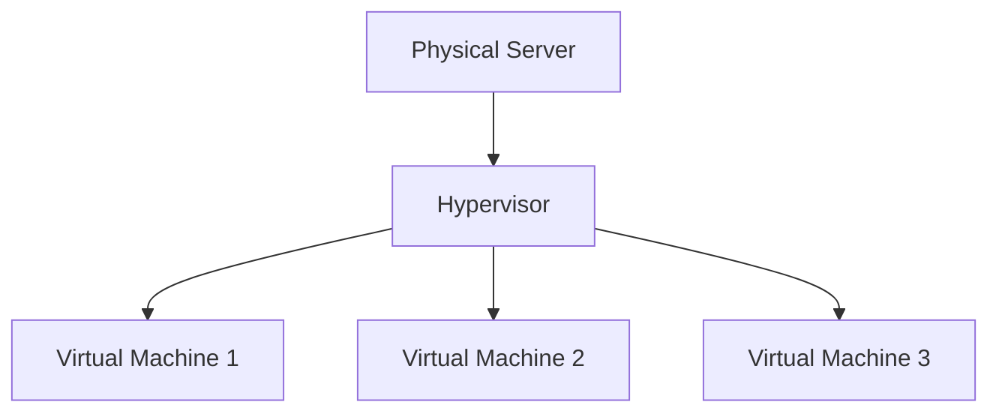

### Logical Isolation

Each virtual machine works like an independent environment even though they share the same physical hardware.

## Cloud Computing

Cloud computing allows us to use computing resources over the internet without managing all the physical hardware ourselves.

### Concepts I Learned

- Cloud Infrastructure
- Virtual Servers
- Compute Resources
- AWS
- EC2
- APIs
- Automation

## AWS EC2

Amazon EC2 provides virtual servers in AWS. We can launch instances and use them to run applications.

### Concepts I Learned

- EC2 Instances
- AMI (Amazon Machine Image)
- Instance Types
- Key Pairs
- Cloud Infrastructure
- Connecting to EC2

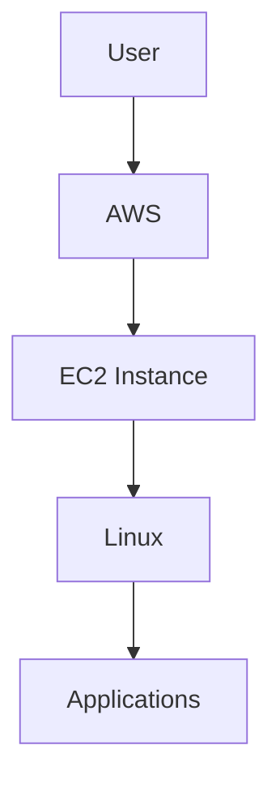

## API – Application Programming Interface

An API allows one application or system to communicate with another.

For example, when we run an AWS CLI command, it sends a request to an AWS service through an API.

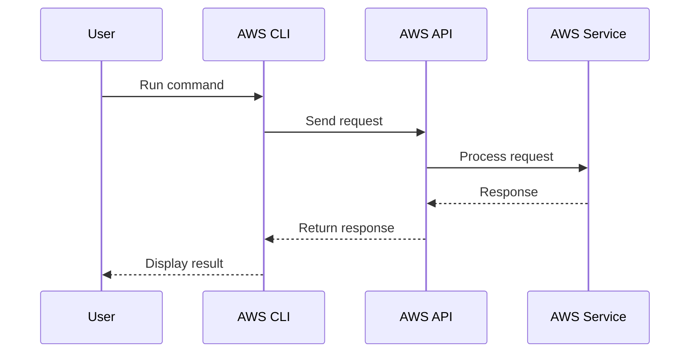

**My takeaway:** Virtualization helps us use hardware efficiently, while cloud computing provides access to computing resources on demand.

---

# Day 04 – Linux, AWS CLI & Infrastructure as Code

## Operating System

An Operating System manages the hardware and software resources of a computer.

### Concepts I Learned

- Operating System
- Kernel
- System Libraries
- Compiler
- Shell
- Hardware
- Applications

## Kernel

The kernel is the core part of an operating system. It manages communication between software and hardware.

### It Manages

- CPU
- Memory
- Processes
- Storage
- Devices
- Networking

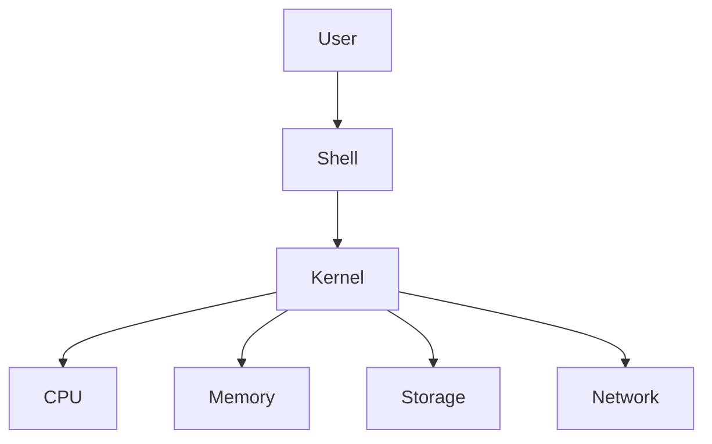

## System Libraries

System libraries provide functions that applications use to interact with the operating system.

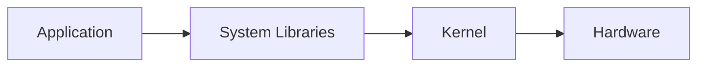

## Compiler

A compiler converts source code into a form that can be executed by a computer.

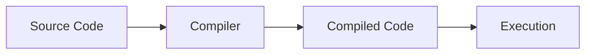

## Shell

A shell provides an interface between the user and the operating system. We can use it to execute commands.

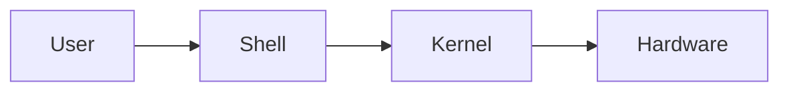

## AWS CLI

AWS CLI (Command Line Interface) allows us to manage AWS services using terminal commands.

Example:

```bash
aws ec2 describe-instances
```

This command displays information about EC2 instances.

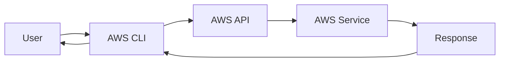

## Infrastructure as Code (IaC)

Infrastructure as Code allows us to create and manage infrastructure using code instead of manually creating resources.

### Tools I Learned About

- AWS CloudFormation
- AWS CDK
- Terraform

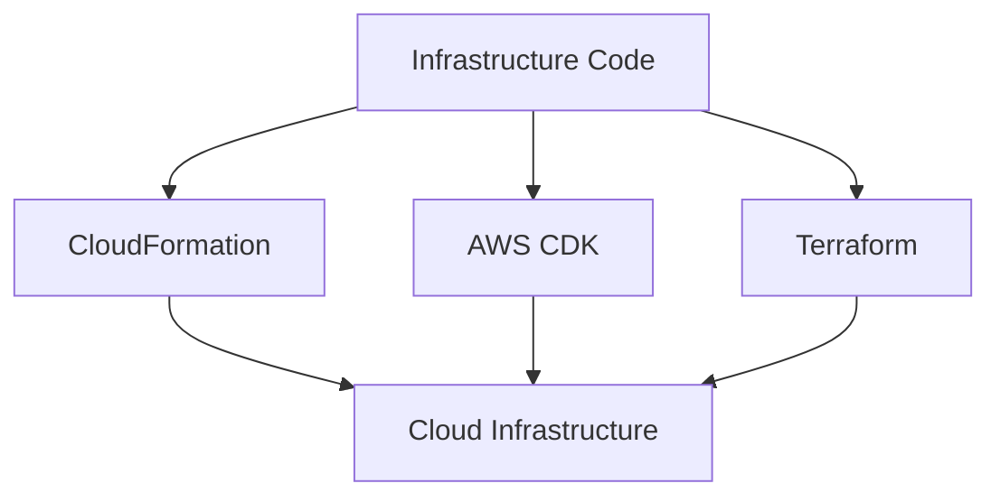

## EC2 Key Pair

An EC2 key pair is used to securely connect to an EC2 instance through SSH.

It contains:

- Public Key
- Private Key

The public key is placed on the EC2 instance, while the private key stays with the user.

**My takeaway:** Linux, AWS CLI and IaC are important foundations for managing cloud infrastructure.

---

# Day 05 – Shell Scripting, Linux Monitoring & Git

## Shell Scripting

Shell scripting allows us to write multiple Linux commands in a file and execute them together.

Example:

```bash
#!/bin/bash

echo "Hello DevOps"
```

## Shell Script Execution Flow

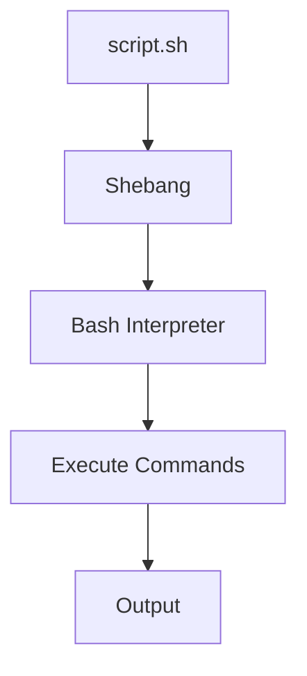

## SH vs BASH

### /bin/sh

A path to a standard shell interface. The actual shell depends on the system.

### /bin/bash

A path to the Bash shell, which provides additional scripting features.

### Shebang

The shebang tells the system which interpreter to use when executing a script.

```bash
#!/bin/sh
```

Or

```bash
#!/bin/bash
```

## Vim Editor

Vim is a text editor used to create and edit files directly from the terminal.

Example:

```bash
vim calculator.sh
```

### Save and Exit

```text
ESC
:wq
ENTER
```

## File Permissions

We can use `chmod` to change file permissions.

Example:

```bash
chmod +x script.sh
```

This adds execute permission to the script.

## Shell Debugging

### set -x

Displays commands while the script is running.

```bash
set -x
```

### set -e

Stops the script when a command fails with a non-zero exit status in applicable cases.

```bash
set -e
```

### set -o

Displays or manages shell options.

```bash
set -o
```

## grep

`grep` is used to search for specific text in command output or files.

Example:

```bash
ps -ef | grep amazon
```

## Pipe (|)

A pipe sends the output of one command as input to another command.

Example:

```bash
ps -ef | grep amazon
```

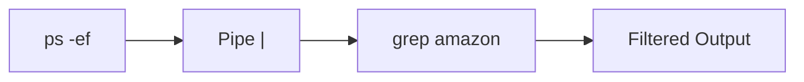

## Linux Monitoring

I learned some basic commands to check server resources and running processes.

| Command | Purpose |
|---|---|
| `top` | Monitor running processes and resource usage |
| `df -h` | Check disk usage |
| `free -h` | Check memory usage |
| `ps -ef` | View running processes |

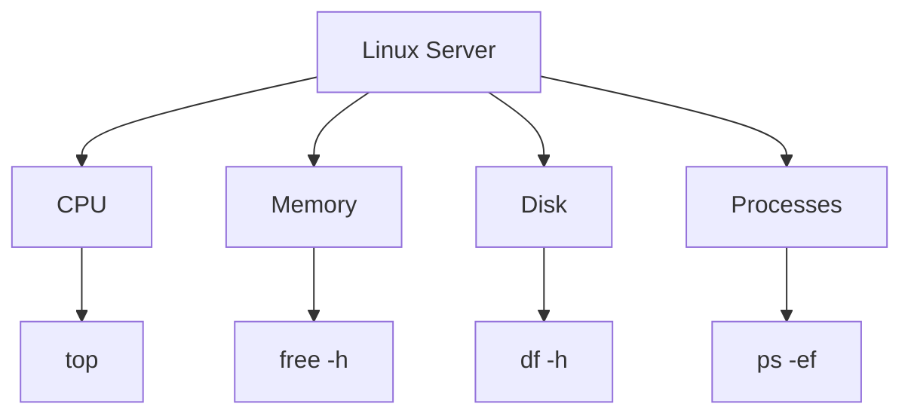

## Git Branching

A Git branch allows us to work on different features without directly changing the main branch.

### Branch Types

- Main Branch
- Feature Branch
- Release Branch
- Hotfix Branch

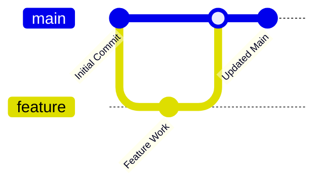

## GitFlow

GitFlow is a branching model used to organize development and releases.

| Branch | Purpose |
|---|---|
| `main` | Production-ready code |
| `feature` | Develop new features |
| `release` | Prepare a new release |
| `hotfix` | Fix critical production issues |

**My takeaway:** Shell scripting helps automate repetitive tasks. Linux monitoring helps us understand server resources, and Git branching helps organize code changes.

---

# Day 06 – Git, GitHub, Remote, Clone, Fork & SSH

## Git Repository

A Git repository stores project files and tracks their changes over time.

To initialize a Git repository:

```bash
git init
```

This creates a hidden `.git` directory.

## .git Directory

The `.git` directory stores Git's internal information, including commit history, branches and repository configuration.

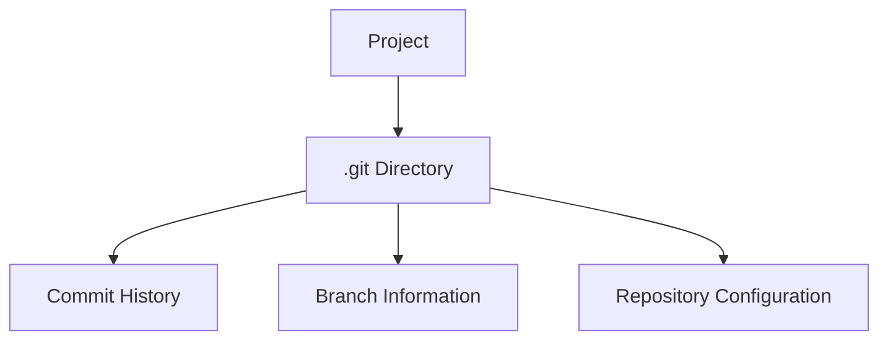

## Git Workflow

Git has three important areas:

- Working Directory
- Staging Area
- Git Repository

```mermaid
flowchart LR
    A["Working Directory"] -->|"git add"| B["Staging Area"]
    B -->|"git commit"| C["Git Repository"]
```

## Basic Git Commands

### 1. git status

```bash
git status
```

Shows the current branch and the status of modified, untracked and staged files.

### 2. git add

Adds changes to the staging area.

Add a single file:

```bash
git add calculator.sh
```

Add all changes:

```bash
git add .
```

### 3. git commit

Saves staged changes into Git history.

```bash
git commit -m "Add calculator script"
```

### 4. git log

Displays the commit history.

```bash
git log
```

## Git Remote

A remote connects our local Git repository to a repository hosted on another platform, such as GitHub.

Add a remote:

```bash
git remote add origin <repository-url>
```

Check remote details:

```bash
git remote -v
```

## Local Repository and Remote Repository

```mermaid
flowchart LR
    LOCAL["Local Repository"]
    REMOTE["GitHub Repository"]

    LOCAL -->|"git push"| REMOTE
    REMOTE -->|"git fetch"| LOCAL
    REMOTE -->|"git pull"| LOCAL
```

## 5. git push

Uploads local commits to the remote repository.

```bash
git push
```

## 6. git fetch

Downloads information about remote changes without merging them into the current branch.

```bash
git fetch
```

## 7. git pull

Downloads remote changes and integrates them into the current local branch.

```bash
git pull
```

## 8. git clone

Downloads an existing repository from GitHub to our local machine.

```bash
git clone <repository-url>
```

```mermaid
flowchart LR
    A["GitHub Repository"] --> B["git clone"]
    B --> C["Local Machine"]
```

## Git Fork

A fork creates a copy of another person's repository under our own GitHub account.

It is commonly used when contributing to open-source projects.

```mermaid
flowchart LR
    A["Original Repository"] --> B["Fork"]
    B --> C["Your GitHub Repository"]
    C --> D["Clone"]
    D --> E["Local Machine"]
```

## Clone vs Fork

| Clone | Fork |
|---|---|
| Copies a repository to your local machine | Creates a copy on GitHub |
| Done using Git | Done through GitHub |
| Used for local development | Commonly used for contributions |

---

# SSH Authentication

SSH stands for Secure Shell. It provides a secure way to connect to remote systems.

I learned how SSH keys are used to authenticate a machine with GitHub.

### Concepts I Learned

- SSH
- SSH Key Pair
- Public Key
- Private Key
- `ssh-keygen`
- `~/.ssh`
- GitHub Authentication
- EC2 to GitHub Authentication

## SSH Key Generation

Generate an SSH key pair:

```bash
ssh-keygen
```

Check the generated keys:

```bash
ls -al ~/.ssh
```

View the public key:

```bash
cat ~/.ssh/id_ed25519.pub
```

## SSH Architecture

The private key stays on the machine, and the public key is added to GitHub.

```mermaid
flowchart LR
    EC2["EC2 Server"]
    PRIVATE["Private Key"]
    PUBLIC["Public Key"]
    GITHUB["GitHub"]

    EC2 --> PRIVATE
    EC2 --> PUBLIC
    PUBLIC --> GITHUB
    PRIVATE -.->|"Authentication"| GITHUB
```

**Important:**

- Private Key: Keep it secure and never share it.
- Public Key: Add it to your GitHub account.

## Test SSH Connection

```bash
ssh -T git@github.com
```

This command checks whether SSH authentication with GitHub is working.

## Complete SSH and GitHub Flow

```mermaid
sequenceDiagram
    participant E as EC2
    participant K as SSH Keys
    participant G as GitHub

    E->>K: Generate keys using ssh-keygen
    K-->>E: Public and Private Keys
    E->>G: Add Public Key
    E->>G: Connect using SSH
    G->>E: Verify authentication
    E->>G: Perform Git operations
```

---

# Complete Git and GitHub Workflow

This is the basic workflow I followed to upload a local project to GitHub.

```mermaid
flowchart TD
    A["Create Project"] --> B["git init"]
    B --> C["Create or Modify Files"]
    C --> D["git status"]
    D --> E["git add"]
    E --> F["git commit"]
    F --> G["git remote add origin"]
    G --> H["git push"]
    H --> I["GitHub Repository"]
```

# GitHub Collaboration Workflow

GitHub allows multiple developers to work on the same project.

```mermaid
flowchart LR
    D1["Developer 1"] --> L1["Local Repository"]
    L1 -->|"git push"| GH["GitHub"]
    GH -->|"git clone / pull"| D2["Developer 2"]
    D2 -->|"git push"| GH
    GH -->|"git fetch / pull"| L1
```

---

# Complete Concept Map

```mermaid
mindmap
  root((DevOps and Cloud))
    Day 01 - DevOps
      Automation
      Collaboration
      Reliability
      Monitoring
      Feedback
    Day 02 - Software Design
      SDLC
      SRS
      HLD
      LLD
    Day 03 - Cloud
      Servers
      Virtualization
      Hypervisor
      Virtual Machines
      AWS EC2
      APIs
    Day 04 - Linux and AWS
      Operating System
      Kernel
      System Libraries
      Compiler
      Shell
      AWS CLI
      Infrastructure as Code
      CloudFormation
      AWS CDK
      Terraform
    Day 05 - Automation
      Shell Scripting
      Bash and SH
      Vim
      File Permissions
      Debugging
      grep and Pipes
      Linux Monitoring
      Git Branching
      GitFlow
    Day 06 - Git and GitHub
      Git Repository
      Working Directory
      Staging Area
      Commits
      Remote
      Push and Pull
      Fetch
      Clone and Fork
      SSH Authentication
```

---

# What I Have Learned So Far

| Day | Main Focus | Hands-on Learning |
|---|---|---|
| 01 | DevOps Fundamentals | DevOps lifecycle and workflow |
| 02 | SDLC, HLD and LLD | Software design concepts |
| 03 | Servers and Virtualization | AWS EC2 and API concepts |
| 04 | Linux, AWS CLI and IaC | Linux commands and AWS CLI |
| 05 | Shell Scripting and Monitoring | Bash scripts, monitoring and Git branches |
| 06 | Git, GitHub and SSH | Git commands, remote repositories and SSH authentication |

# My Key Takeaways

- **Day 01:** DevOps is about collaboration, automation and continuous improvement.
- **Day 02:** SDLC explains the software development process. HLD and LLD explain system design at different levels.
- **Day 03:** Virtualization allows multiple virtual machines to run on shared physical hardware.
- **Day 04:** Linux, AWS CLI and IaC are important for managing cloud infrastructure.
- **Day 05:** Shell scripting helps automate tasks, while monitoring helps us understand server performance.
- **Day 06:** Git manages code history, GitHub hosts repositories, and SSH provides secure authentication.

# What's Next?

I will continue learning and practising the following technologies.

```mermaid
flowchart TD
    A["Docker"] --> B["AWS"]
    B --> C["CI/CD"]
    C --> D["Terraform"]
    D --> E["Kubernetes"]
    E --> F["Monitoring"]
    F --> G["Security"]
    G --> H["DevOps Automation"]
    H --> I["Real-World Projects"]
```

# My Learning Approach

I don't want to just memorize commands. I want to understand what they do, why we use them and how to troubleshoot problems.

```mermaid
flowchart TD
    A["Learn"] --> B["Practice"]
    B --> C["Build"]
    C --> D["Break"]
    D --> E["Fix"]
    E --> F["Understand"]
    F --> G["Document"]
    G --> A
```

# My Documentation Approach

I follow a simple learning and documentation routine.

**Monday to Friday**
- Learn new concepts.
- Practise commands.
- Work on hands-on labs.
- Build projects.
- Debug problems.

**Saturday and Sunday**
- Review what I learned.
- Organize my notes.
- Document experiments.
- Write technical blogs.
- Update GitHub repositories.

**Weekdays:** Learn, Practice and Build.

**Weekends:** Review, Document and Publish.

---

# The Journey Continues

**Day 01 to Day 06 Complete**

I am still learning, practising and improving every day. My goal is to understand how things work, gain hands-on experience and build real-world projects.

**Learn → Practice → Build → Break → Fix → Understand → Document → Repeat**
