# My DevOps & Cloud Learning Journey

## Day 06 – Day 12

My learning journey continued with Git, GitHub, AWS, Ansible, Terraform and Docker. During these days, I started understanding how different DevOps tools work together.

---

# My Learning Roadmap

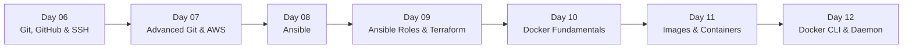

# Day 06 – Git, GitHub, Remote & SSH

## Git Repository

A Git repository stores project files and tracks their changes.

To create a repository:

```bash
mkdir gitdemo
cd gitdemo
git init
```

The `git init` command creates a hidden `.git` directory.

### What is the .git directory?

The `.git` directory stores Git information such as:

- Commit history
- Branch information
- Repository configuration
- References

To view hidden files:

```bash
ls -a
```

## Git Workflow

Git has three main areas:

1. Working Directory
2. Staging Area
3. Git Repository

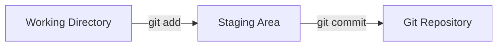

### Basic Git Commands

**Check repository status**

```bash
git status
```

**Add files to staging**

```bash
git add calculator.sh
git add .
```

**Commit changes**

```bash
git commit -m "Add calculator script"
```

**View commit history**

```bash
git log
git log --oneline
```

## Git Remote

A remote connects our local repository to a repository hosted on GitHub.

The commonly used remote name is `origin`.

Add a remote:

```bash
git remote add origin <repository-url>
```

Check remote details:

```bash
git remote -v
```

## Git Push and Fetch

**git push**

Uploads local commits to GitHub.

```bash
git push -u origin main
```

**git fetch**

Downloads information about remote changes without directly merging them into the current branch.

```bash
git fetch
```

**git pull**

Downloads remote changes and integrates them into the current branch.

```bash
git pull
```

## Git Clone

`git clone` downloads an existing repository to our local machine.

```bash
git clone <repository-url>
```

We can also clone using SSH:

```bash
git clone git@github.com:USERNAME/REPOSITORY.git
```

## Git Fork

A fork creates a copy of another user's repository under our GitHub account.

It is commonly used when contributing to open-source projects.

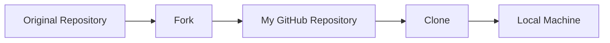

### Clone vs Fork

| Clone | Fork |
|---|---|
| Downloads a repository locally | Creates a copy on GitHub |
| Uses `git clone` | Uses GitHub Fork |
| Local operation | GitHub operation |
| Used for local development | Useful for contributing |

## SSH Authentication

SSH stands for Secure Shell. It provides a secure way to connect to remote systems.

I learned how SSH keys help an EC2 instance authenticate with GitHub.

SSH uses two keys:

- **Private Key:** Stays on the machine.
- **Public Key:** Added to GitHub.

Generate SSH keys:

```bash
ssh-keygen
```

Check generated keys:

```bash
ls -al ~/.ssh
```

View the public key:

```bash
cat ~/.ssh/id_ed25519.pub
```

Test the connection:

```bash
ssh -T git@github.com
```

### SSH Authentication Flow

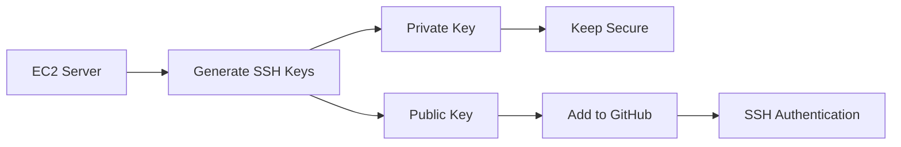

**Important:** Never share your private key.

After successful authentication, EC2 can communicate with GitHub using Git commands such as clone, push, pull and fetch.

## Git Branching and GitFlow

A branch allows developers to work on different features without directly changing the main branch.

Common branch types:

| Branch | Purpose |
|---|---|
| `main` | Production-ready code |
| `feature` | Develop new features |
| `release` | Prepare a release |
| `hotfix` | Fix critical production issues |

Example:

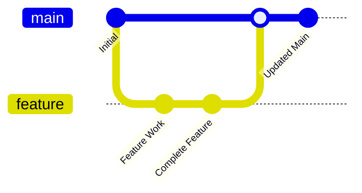

**My takeaway:** Git manages code changes, GitHub hosts repositories, and SSH provides secure authentication.

---

# Day 07 – Advanced Git & AWS Application Deployment

During Day 07, I learned some advanced Git commands and understood how Git helps manage changes in a project.

I also got introduced to Ansible and practised the basic process of deploying a Node.js application on AWS EC2.

## Advanced Git Commands

### git diff

Shows the changes made to files.

```bash
git diff
```

### git restore

Restores file changes in the working directory.

```bash
git restore file.txt
```

Be careful because this can discard uncommitted changes.

### git rm

Removes a tracked file from the working directory and stages its removal.

```bash
git rm file.txt
```

### git reset

Used to move the current branch and update the staging area depending on the reset option.

```bash
git reset
```

### Git Configuration

We can configure our Git username and email.

```bash
git config --global user.name "Your Name"
git config --global user.email "your@email.com"
```

## Advanced Branch Workflow

Different branches allow developers to work on features and bug fixes separately.

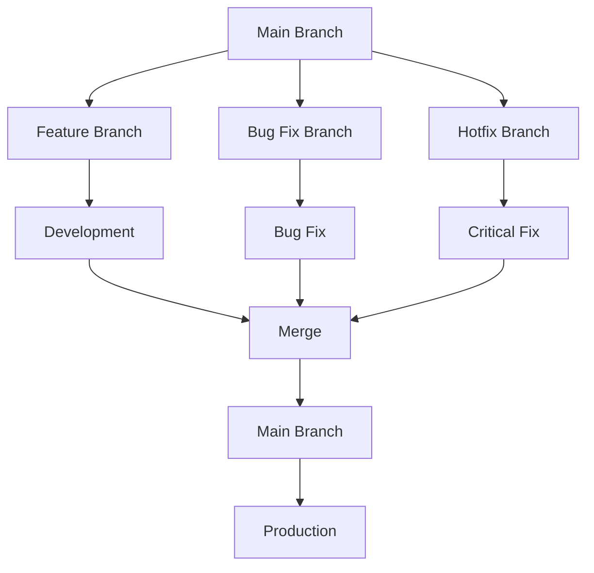

## Introduction to Ansible

Ansible is an automation and configuration management tool.

It helps automate repetitive server tasks such as:

- Software installation
- Server configuration
- Package updates
- File management
- Application deployment

## AWS EC2 – Node.js Application Deployment

I practised the basic steps involved in deploying a Node.js application on an AWS EC2 instance.

### Deployment Flow

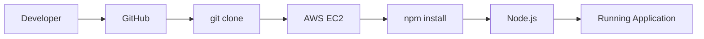

### Step 1: Clone the Application

```bash
git clone <repository-url>
cd <project-folder>
```

### Step 2: Update Packages

```bash
sudo apt update
```

### Step 3: Install npm

```bash
sudo apt install npm
```

### Step 4: Install Dependencies

```bash
npm install
```

### Step 5: Start the Application

```bash
npm run start
```

## EC2 Access Concepts

I also learned about:

- EC2 instances
- SSH connections
- IAM
- Permissions
- Security
- Application access

**My takeaway:** Advanced Git commands help manage code changes, while AWS EC2 provides a server where we can deploy applications.

---

# Day 08 – Ansible & Configuration Management

Day 08 focused on understanding Configuration Management and how Ansible helps automate server administration.

## What is Configuration Management?

Configuration Management is the process of managing and maintaining server configurations.

Without automation, we need to connect to every server and configure it manually.

For example:

```text
SSH → Server 1 → Configure
SSH → Server 2 → Configure
SSH → Server 3 → Configure
SSH → Server 500 → Configure
```

This becomes difficult when the number of servers increases.

### Problems with Manual Configuration

- Takes more time
- Human errors
- Repetitive work
- Difficult to manage multiple servers
- Configuration differences between servers

## What is Ansible?

Ansible is an automation tool that allows us to manage multiple servers from one controller.

It can automate:

- Software installation
- Package updates
- Server configuration
- File management
- Application deployment
- Repetitive tasks

## Ansible Architecture

Ansible uses a controller to communicate with managed servers.

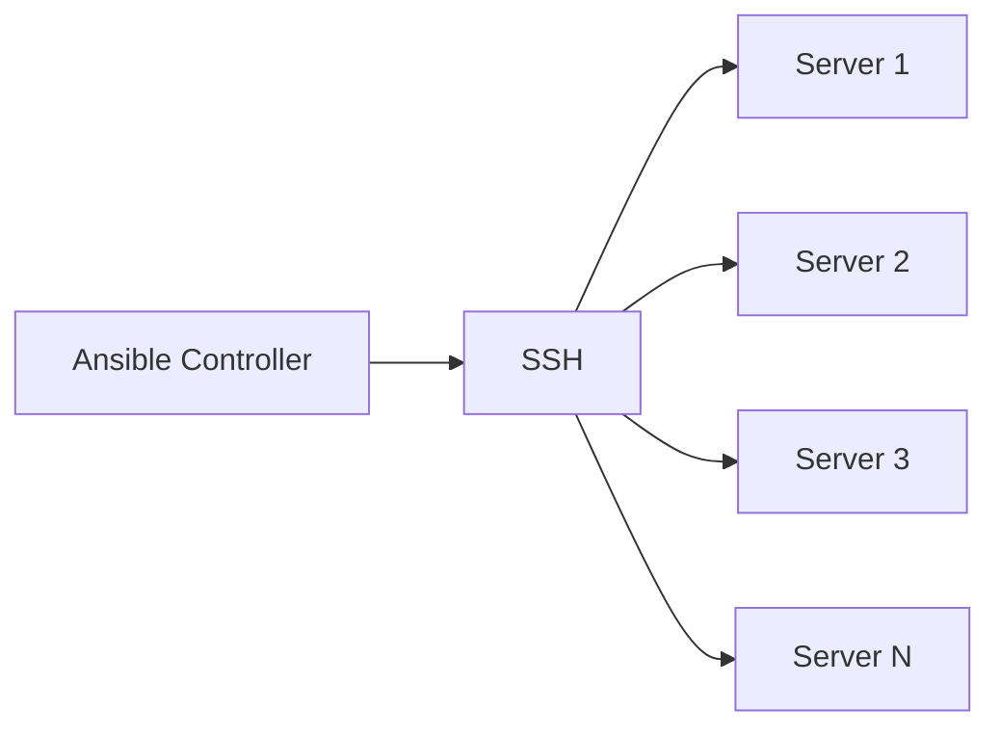

Ansible commonly uses an agentless approach for Linux server management through SSH.

## Master-Agent vs Agentless

| Master-Agent | Ansible |
|---|---|
| Requires agents | No agent required for common SSH-based Linux management |
| Master communicates with agents | Controller connects through SSH |
| More components to manage | Simpler setup |

## Push vs Pull

**Push Model**

The controller sends configurations or tasks to managed servers.

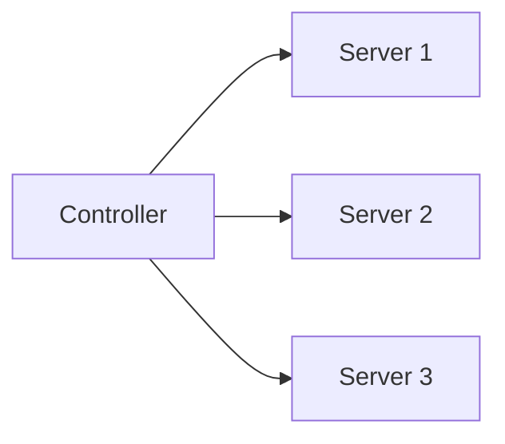

**Pull Model**

Managed servers obtain their configuration from a central source.

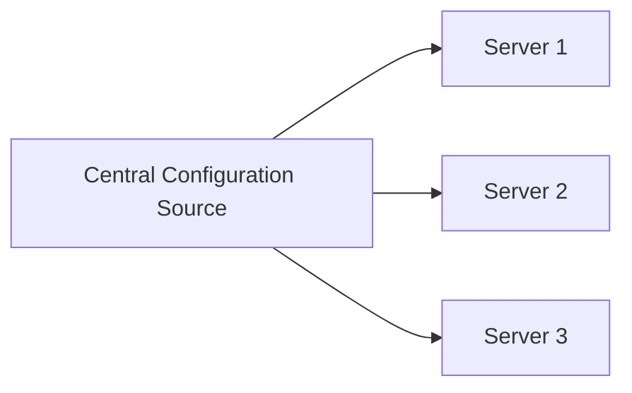

## Ansible Playbook

A Playbook defines what Ansible should do.

Playbooks are written in YAML.

Example:

```yaml
- name: Install Git
  hosts: all

  tasks:
    - name: Install Git
      package:
        name: git
        state: present
```

## Ansible Inventory

Inventory defines which servers Ansible should manage.

Example:

```ini
[webservers]
server1
server2
server3
```

We can also use IP addresses:

```ini
[webservers]
192.168.1.10
192.168.1.11
192.168.1.12
```

Remember:

- **Playbook:** What should be done?
- **Inventory:** Where should it be done?

## Dynamic Inventory

Cloud infrastructure can change frequently. New EC2 instances may be created and existing instances may be removed.

Dynamic Inventory helps Ansible identify the available infrastructure automatically.

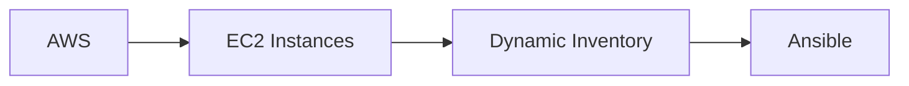

## SSH Authentication

Ansible commonly uses SSH to connect to Linux servers.

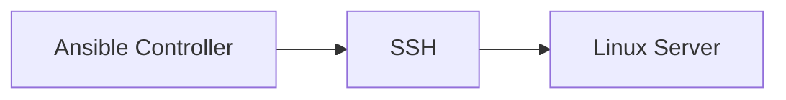

The private key stays with the client, and the corresponding public key is configured on the server.

## Ansible and Python

Ansible is built using Python and has a Python-based ecosystem.

## Three Important Ansible Concepts

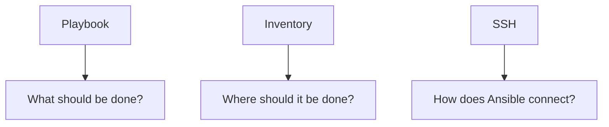

**My takeaway:** Ansible helps manage multiple servers without configuring each server manually.

---

# Day 09 – Ansible Roles, Terraform & DevOps Operations

Day 09 focused on making Ansible automation more organized and reusable. I also learned the basics of Terraform and some important DevOps operations concepts.

## Ansible Playbook

A Playbook defines the automation tasks that Ansible should perform.

Example:

```yaml
- hosts: webservers
  roles:
    - nginx
```

## Ansible Roles

A Role organizes automation into reusable components.

Example folder structure:

```text
ansible-project/
│
├── site.yml
│
└── roles/
    └── nginx/
        ├── tasks/
        ├── handlers/
        ├── vars/
        ├── defaults/
        ├── templates/
        ├── files/
        └── meta/
```

Roles make automation:

- Reusable
- Organized
- Modular
- Easier to understand
- Easier to maintain

## Tasks

Tasks contain the actual work Ansible performs.

Example:

```yaml
- name: Install Nginx
  package:
    name: nginx
    state: present

- name: Start Nginx
  service:
    name: nginx
    state: started
```

## Handlers

Handlers are tasks that run when another task notifies them.

For example, when an Nginx configuration changes, we can notify a handler to restart Nginx.

Example:

```yaml
- name: Update Nginx configuration
  template:
    src: nginx.conf.j2
    dest: /etc/nginx/nginx.conf
  notify: Restart nginx
```

Handler:

```yaml
- name: Restart nginx
  service:
    name: nginx
    state: restarted
```

### Handler Workflow

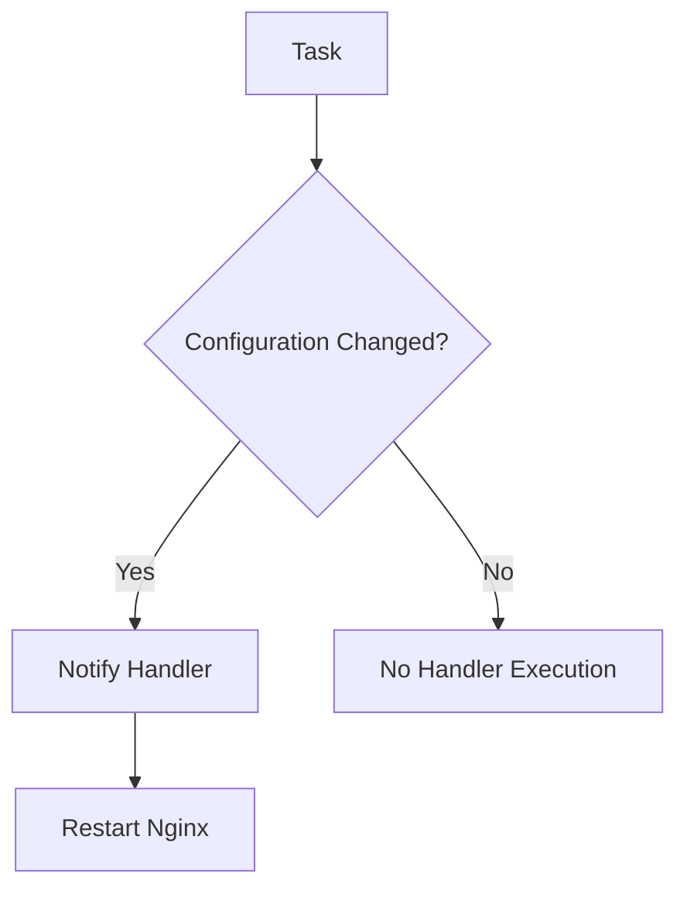

## Variables

Variables store values that can be reused in Playbooks and Roles.

Example:

```yaml
nginx_port: 80
```

We can use variables inside tasks:

```yaml
- name: Install Package
  package:
    name: "{{ package_name }}"
    state: present
```

## Templates

Ansible uses Jinja2 templates to generate configuration files dynamically.

Example:

```text
nginx.conf.j2
```

```nginx
server {
    listen {{ nginx_port }};
}
```

## Files

The `files/` directory stores static files that Ansible can copy to managed servers.

Example:

```text
roles/
└── nginx/
    └── files/
        └── index.html
```

## Playbook vs Role

| Concept | Purpose |
|---|---|
| Playbook | Defines the automation flow |
| Role | Organizes reusable automation |
| Task | Performs an action |
| Handler | Runs when notified |
| Variable | Stores reusable values |
| Template | Generates dynamic configuration |
| Files | Stores static files |
| Inventory | Defines managed servers |

## Terraform Basics

Terraform is an Infrastructure as Code tool.

It allows us to define and manage infrastructure using configuration files.

### Important Terraform Commands

```bash
terraform init
terraform validate
terraform plan
terraform apply
terraform destroy
```

### Terraform Workflow

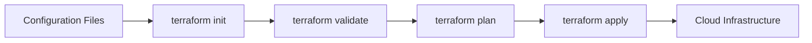

## Incident Management

Incident Management deals with unexpected problems that affect services.

Example: A production server suddenly stops working.

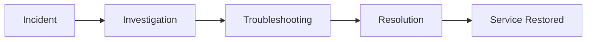

## Change Management

Change Management handles planned changes to systems and infrastructure.

Example: Upgrading a production server.

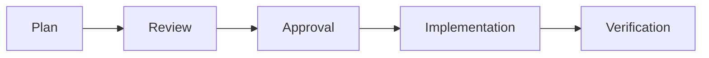

### Incident Management vs Change Management

| Incident Management | Change Management |
|---|---|
| Handles unexpected issues | Handles planned changes |
| Example: Server failure | Example: Server upgrade |
| Focuses on restoring services | Focuses on implementing changes safely |

## JIRA

JIRA is a tool used by teams to manage:

- Projects
- Tasks
- Issues
- Bugs
- Team activities

## ServiceNow

ServiceNow is commonly used for IT Service Management.

It helps manage:

- Incidents
- Changes
- Service requests
- IT operations

### JIRA vs ServiceNow

| JIRA | ServiceNow |
|---|---|
| Software development and project management | IT Service Management |
| Tasks and issues | Incidents and changes |
| Development workflows | IT operations workflows |

## Root and Sudo

**Root**

Root is the superuser in Linux. It has extensive administrative permissions.

**sudo**

The `sudo` command allows an authorized user to execute commands with elevated privileges.

Example:

```bash
sudo command
```

## Docker Permissions

Docker commands may require additional permissions.

Example:

```bash
sudo docker ps
```

We can also add the current user to the Docker group:

```bash
sudo usermod -aG docker $USER
newgrp docker
docker ps
```

Note: Docker group membership provides powerful access to the system. It should be treated as privileged access.

### Day 09 Learning Flow

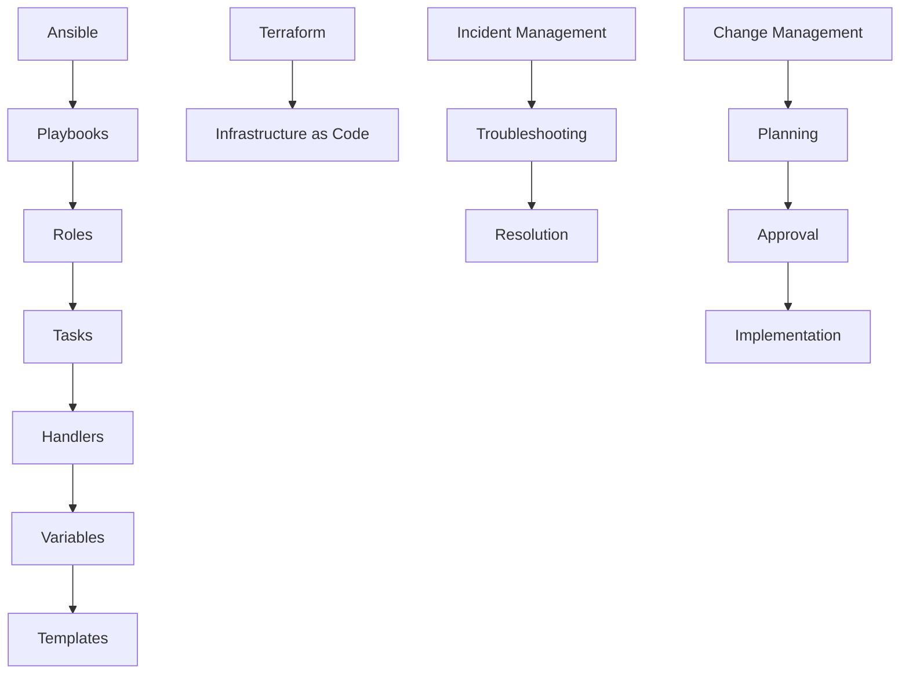

**My takeaway:** Ansible Roles help organize automation, Terraform helps manage infrastructure through code, and Incident and Change Management are important parts of DevOps operations.

---

# Day 10 – Docker & Containerization

Day 10 introduced me to Docker and the basic concepts of containerization.

I learned how applications are packaged and run inside containers.

## What is Containerization?

Containerization is a way of packaging an application with its required dependencies and configuration.

It helps applications run consistently across different environments.

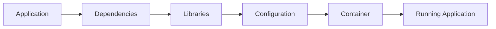

## What is Docker?

Docker is a platform used to build, package and run applications inside containers.

A container can include:

- Application code
- Runtime
- Libraries
- Dependencies
- Configuration

## Dockerfile

A Dockerfile contains instructions used to build a Docker image.

Example:

```dockerfile
FROM ubuntu

RUN apt update

CMD ["echo", "Hello Docker"]
```

### Important Dockerfile Instructions

| Instruction | Purpose |
|---|---|
| `FROM` | Specifies the base image |
| `RUN` | Executes commands during image build |
| `CMD` | Defines the default command when a container starts |

## Docker Image

A Docker image is a read-only template used to create containers.

It contains the application and its required dependencies.

## Docker Container

A container is a running instance of a Docker image.

Containers:

- Are lightweight
- Share the host OS kernel
- Provide isolation
- Package applications with dependencies
- Can run multiple applications on the same host

### Image vs Container

| Image | Container |
|---|---|
| Template or blueprint | Running instance of an image |
| Used to create containers | Used to run applications |
| Read-only image layers | Has a writable container layer |

## Virtual Machine vs Container

| Virtual Machine | Container |
|---|---|
| Has a guest OS | Shares the host OS kernel |
| Heavier | Lightweight |
| Uses more resources | Generally uses fewer resources |
| Usually slower to start | Usually faster to start |
| Provides a complete OS environment | Packages an application and dependencies |

### Main Difference

A virtual machine generally runs its own guest operating system. A container shares the host operating system kernel.

## Docker Engine

Docker Engine manages Docker resources and operations.

It manages:

- Images
- Containers
- Networks
- Volumes

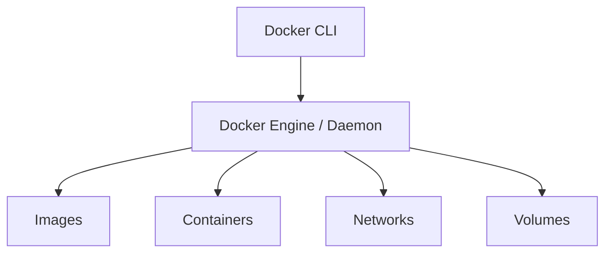

## Docker Workflow

```mermaid
flowchart LR
    A["Dockerfile"] --> B["docker build"]
    B --> C["Docker Image"]
    C --> D["docker run"]
    D --> E["Docker Container"]
    E --> F["Application"]
```

## OCI – Open Container Initiative

OCI stands for Open Container Initiative.

It provides standards for container images and container runtimes.

## Docker vs Buildah vs Podman

| Tool | Main Purpose |
|---|---|
| Docker | Build images and run containers |
| Buildah | Build container images |
| Podman | Run and manage containers |

## Docker Registry

A Docker Registry stores and distributes container images.

```mermaid
flowchart LR
    A["Developer"] --> B["Build Image"]
    B --> C["Push"]
    C --> D["Container Registry"]
    D --> E["Pull"]
    E --> F["Docker Host"]
    F --> G["Container"]
```

**My takeaway:** Docker makes it easier to package applications and run them in consistent environments.

---

# Day 11 – Docker Containers, Images & Docker Hub

Day 11 focused on understanding Docker containers in more detail. I learned about logical isolation, Linux filesystems inside containers, images, registries and Docker Hub.

## Logical Isolation

Containers provide isolated environments for applications.

This helps prevent unnecessary interference between containers.

```mermaid
flowchart LR
    A["Container A"] --> B["Application A"]
    C["Container B"] --> D["Application B"]

    B -.-> E["Separate Environments"]
    D -.-> E
```

Isolation helps reduce:

- Unwanted file access
- Application interference
- Exposure of sensitive information
- Security risks

## Linux Filesystem Inside Containers

I learned about some important Linux directories.

| Directory | Purpose |
|---|---|
| `/bin` | Binary executable files |
| `/sbin` | System administration binaries |
| `/etc` | Configuration files |
| `/lib` | Libraries |
| `/usr` | Utilities and applications |
| `/root` | Root user's home directory |

## Why Are Containers Lightweight?

Containers share the host operating system kernel instead of requiring a complete guest operating system.

```mermaid
flowchart TD
    A["Physical Machine"] --> B["Host OS + Kernel"]
    B --> C["Docker Engine"]
    C --> D["Container"]
    D --> E["Application + Dependencies"]
```

### Advantages of Containers

- Fast startup
- Lightweight
- Lower resource usage
- Portability
- Easier deployment

## One Image to Multiple Containers

One Docker image can be used to create multiple containers.

```mermaid
flowchart TD
    A["NGINX Image"] --> B["Container 1"]
    A --> C["Container 2"]
    A --> D["Container 3"]
```

## Dockerfile to Container

```mermaid
flowchart TD
    A["Dockerfile"] --> B["docker build"]
    B --> C["Docker Image"]
    C --> D["docker run"]
    D --> E["Docker Container"]
    E --> F["Application"]
```

## Docker Hub

Docker Hub is a public registry used to store and share Docker images.

Developers can upload images and other users can download them.

```mermaid
flowchart LR
    A["Developer"] --> B["Build Image"]
    B --> C["docker push"]
    C --> D["Docker Hub"]
    D --> E["docker pull"]
    E --> F["Another Developer"]
    F --> G["Run Container"]
```

### Docker Pull

Downloads an image from a registry.

```bash
docker pull nginx
```

### Docker Push

Uploads an image to a registry.

```bash
docker push <username>/<image-name>
```

## Important Docker Concepts

| Concept | Meaning |
|---|---|
| Container | Environment used to run an application |
| Isolation | Separates application environments |
| Image | Template used to create containers |
| Dockerfile | Instructions for building an image |
| Docker Engine | Manages Docker operations |
| Docker CLI | Interface used to communicate with Docker |
| Registry | Stores and distributes images |
| Docker Hub | Public Docker registry |
| Pull | Downloads an image |
| Push | Uploads an image |
| Run | Creates and starts a container |

### Day 11 Workflow

```mermaid
flowchart LR
    A["Developer"] --> B["Dockerfile"]
    B --> C["Build"]
    C --> D["Docker Image"]
    D --> E["Push"]
    E --> F["Docker Hub"]
    F --> G["Pull"]
    G --> H["Run"]
    H --> I["Container"]
    I --> J["Application"]
```

**My takeaway:** Docker images act as templates, while containers are created from those images. Docker Hub makes it easier to share images with other developers.

---

# Day 12 – Docker CLI, Daemon & Permissions

Day 12 focused on understanding how Docker works internally and how the Docker CLI communicates with the Docker Daemon.

## Docker CLI

Docker CLI is the command-line interface used to interact with Docker.

Examples:

```bash
docker --version
docker ps
docker ps -a
docker images
docker pull ubuntu
docker run ubuntu
docker start <container_id>
docker stop <container_id>
docker rm <container_id>
docker rmi <image_id>
docker network ls
docker volume ls
```

## Docker Daemon

The Docker Daemon is a background service that manages Docker resources and operations.

It is commonly represented by:

```bash
dockerd
```

### Responsibilities

- Create containers
- Start and stop containers
- Remove containers
- Build images
- Pull images
- Manage networks
- Manage volumes
- Communicate with registries

## Docker CLI and Docker Daemon

The Docker CLI sends commands to the Docker Daemon. The Daemon performs the requested operations.

```mermaid
flowchart LR
    A["User"] --> B["Docker CLI"]
    B --> C["Docker Daemon"]
    C --> D["Images"]
    C --> E["Containers"]
    C --> F["Networks"]
    C --> G["Volumes"]
```

### Example: docker run ubuntu

When I execute:

```bash
docker run ubuntu
```

The basic flow is:

```mermaid
flowchart TD
    A["docker run ubuntu"] --> B["Docker CLI"]
    B --> C["Docker Daemon"]
    C --> D{"Image Available?"}
    D -->|Yes| E["Create Container"]
    D -->|No| F["Pull Image"]
    F --> E
    E --> G["Start Container"]
```

## Docker Images

To view locally available images:

```bash
docker images
```

## Docker Containers

To view running containers:

```bash
docker ps
```

To view all containers, including stopped ones:

```bash
docker ps -a
```

| Command | Purpose |
|---|---|
| `docker ps` | Shows running containers |
| `docker ps -a` | Shows all containers |

## Docker Networks

Docker networks allow containers to communicate with other containers, the host and external networks.

List networks:

```bash
docker network ls
```

## Docker Volumes

Docker volumes are used for persistent storage.

They allow data to exist independently of a container's lifecycle.

List volumes:

```bash
docker volume ls
```

## Docker Permissions

Sometimes Docker commands fail because the current user does not have permission to communicate with the Docker Daemon.

Example:

```bash
docker ps
```

A permission error may occur.

### Using sudo

One way to run Docker commands with elevated permissions is:

```bash
sudo docker ps
sudo docker images
sudo docker run ubuntu
sudo docker pull ubuntu
```

### Docker Group

We can add the current user to the Docker group.

```bash
sudo usermod -aG docker $USER
```

Apply the group change:

```bash
newgrp docker
```

Test:

```bash
docker ps
```

**Important:** Docker group membership provides powerful access to the Docker Daemon. Treat it as privileged access.

## Docker Pull Workflow

```bash
docker pull ubuntu
```

```mermaid
flowchart LR
    A["Docker CLI"] --> B["Docker Daemon"]
    B --> C["Docker Registry"]
    C --> D["Ubuntu Image"]
    D --> E["Local Docker Host"]
```

## Docker Run Workflow

```bash
docker run ubuntu
```

```mermaid
flowchart TD
    A["docker run ubuntu"] --> B["Docker CLI"]
    B --> C["Docker Daemon"]
    C --> D{"Image Exists?"}
    D -->|Yes| E["Create Container"]
    D -->|No| F["Pull Image"]
    F --> E
    E --> G["Start Container"]
```

## Other Docker Commands

**Stop a container**

```bash
docker stop <container_id>
```

**Start an existing container**

```bash
docker start <container_id>
```

**Remove a container**

```bash
docker rm <container_id>
```

**Remove an image**

```bash
docker rmi <image_id>
```

**Build an image**

```bash
docker build -t my-first-image .
```

## Docker Build Workflow

```mermaid
flowchart LR
    A["Dockerfile"] --> B["docker build"]
    B --> C["Docker Daemon"]
    C --> D["Docker Image"]
```

## Docker Command Cheat Sheet

```bash
# Check Docker version
docker --version

# Show running containers
docker ps

# Show all containers
docker ps -a

# List images
docker images

# Pull an image
docker pull ubuntu

# Run a container
docker run ubuntu

# Start a container
docker start <container_id>

# Stop a container
docker stop <container_id>

# Remove a container
docker rm <container_id>

# Remove an image
docker rmi <image_id>

# List networks
docker network ls

# List volumes
docker volume ls

# Build an image
docker build -t my-image .

# Run Docker with sudo
sudo docker ps

# Add user to Docker group
sudo usermod -aG docker $USER

# Apply group change
newgrp docker
```

### Day 12 Architecture

```mermaid
flowchart TD
    A["User"] --> B["Docker CLI"]
    B --> C["Docker Daemon"]

    C --> D["Images"]
    C --> E["Containers"]
    C --> F["Networks"]
    C --> G["Volumes"]

    D --> E
    F --> E
    G --> E
```

**My takeaway:** Docker CLI is used to send commands, while Docker Daemon manages images, containers, networks and volumes.

---

# Complete Day 06 – Day 12 DevOps Workflow

During these days, I learned how different DevOps tools connect with each other.

```mermaid
flowchart TD
    A["Developer"] --> B["Git"]
    B --> C["GitHub"]
    C --> D["SSH"]
    D --> E["AWS EC2"]

    E --> F["Node.js Application"]

    E --> G["Ansible"]
    G --> H["Playbooks"]
    H --> I["Roles"]
    I --> J["Tasks"]
    J --> K["Managed Servers"]

    L["Terraform"] --> M["Cloud Infrastructure"]

    E --> N["Docker"]
    N --> O["Dockerfile"]
    O --> P["Docker Image"]
    P --> Q["Docker Hub"]
    Q --> R["Docker Container"]
    R --> S["Running Application"]
```

# Day 06 – Day 12 Skills Summary

| Day | Main Focus | Concepts Learned |
|---|---|---|
| 06 | Git and GitHub | Remote, Clone, Fork, SSH and GitFlow |
| 07 | Advanced Git and AWS | Diff, Restore, Reset, Branches and EC2 Deployment |
| 08 | Ansible | Configuration Management, Playbooks, Inventory and SSH |
| 09 | DevOps Operations | Roles, Tasks, Handlers, Terraform, Incidents and Changes |
| 10 | Docker Fundamentals | Containerization, Dockerfile, Images, Containers and OCI |
| 11 | Docker Deep Dive | Isolation, VM vs Container, Registry and Docker Hub |
| 12 | Docker Operations | CLI, Daemon, Networks, Volumes and Permissions |

# Important Concepts I Learned

## Git

```text
Repository
    ↓
Commit
    ↓
Remote
    ↓
Push / Fetch / Pull
    ↓
Clone / Fork
    ↓
Branch / Merge
    ↓
GitFlow
```

## SSH

```text
Private Key → Keep Secure
Public Key → Add to GitHub
    ↓
SSH Authentication
```

## Ansible

```text
Controller
    ↓
SSH
    ↓
Inventory
    ↓
Playbook
    ↓
Roles
    ↓
Tasks
    ↓
Managed Servers
```

## Terraform

```text
Configuration
    ↓
terraform init
    ↓
terraform validate
    ↓
terraform plan
    ↓
terraform apply
    ↓
Infrastructure
```

## Docker

```text
Dockerfile
    ↓
Build
    ↓
Image
    ↓
Registry
    ↓
Pull
    ↓
Run
    ↓
Container
    ↓
Application
```

## Docker Architecture

```text
User
    ↓
Docker CLI
    ↓
Docker Daemon
    ↓
Images / Containers / Networks / Volumes
```

# What I Understand After Day 06 – Day 12

Earlier, I was learning individual DevOps tools. Now I am starting to understand how these tools work together.

- **Git:** Helps track source code changes.
- **GitHub:** Hosts repositories and supports collaboration.
- **SSH:** Provides secure authentication.
- **AWS EC2:** Provides cloud servers to run applications.
- **Ansible:** Automates server configuration and repetitive tasks.
- **Terraform:** Helps manage infrastructure using code.
- **Docker:** Packages applications into containers.
- **Docker Images:** Act as templates for containers.
- **Docker Containers:** Provide isolated environments to run applications.
- **Docker CLI:** Sends commands to Docker.
- **Docker Daemon:** Manages Docker resources.
- **Docker Hub:** Stores and shares Docker images.

# My Learning Approach

I don't want to just memorize commands. I want to understand what they do, why we use them and how to troubleshoot problems.

```mermaid
flowchart TD
    A["Learn"] --> B["Practice"]
    B --> C["Build"]
    C --> D["Break"]
    D --> E["Fix"]
    E --> F["Understand"]
    F --> G["Document"]
    G --> A
```

# What's Next?

I will continue learning more about Docker and other DevOps technologies through practical work and projects.

```mermaid
flowchart TD
    A["Docker"] --> B["Docker Networking"]
    B --> C["Docker Volumes"]
    C --> D["Docker Compose"]
    D --> E["CI/CD"]
    E --> F["Terraform"]
    F --> G["Kubernetes"]
    G --> H["Monitoring"]
    H --> I["Real-World Projects"]
```

---

# Day 06 – Day 12 Complete

These seven days helped me understand Git workflows, server automation, Infrastructure as Code and containerization.

I am continuing to learn, practise and build projects to improve my understanding of DevOps and Cloud.

**Learn → Practice → Build → Break → Fix → Understand → Document → Repeat**
