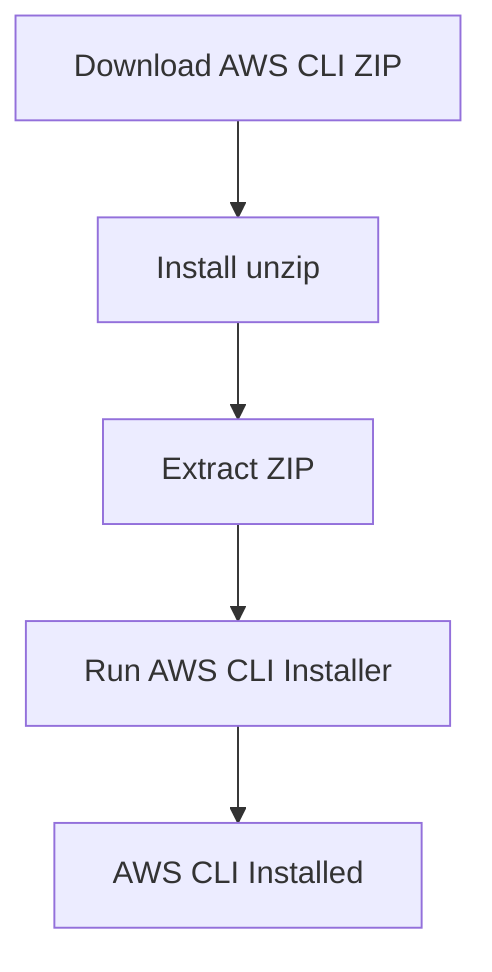
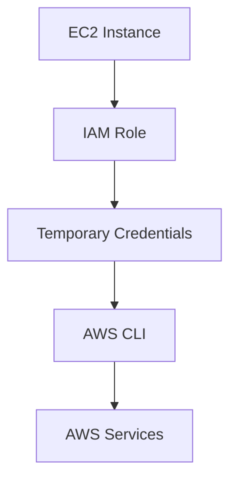
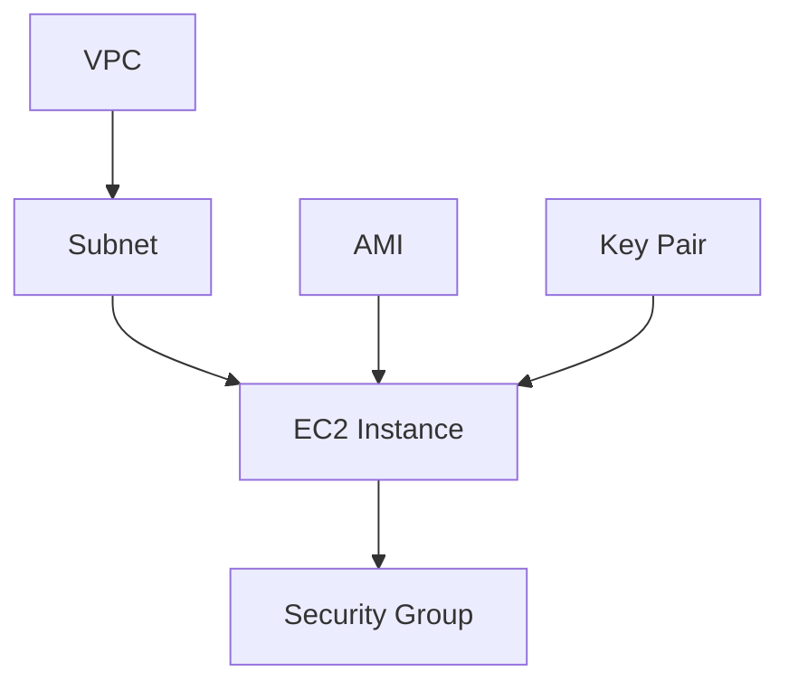
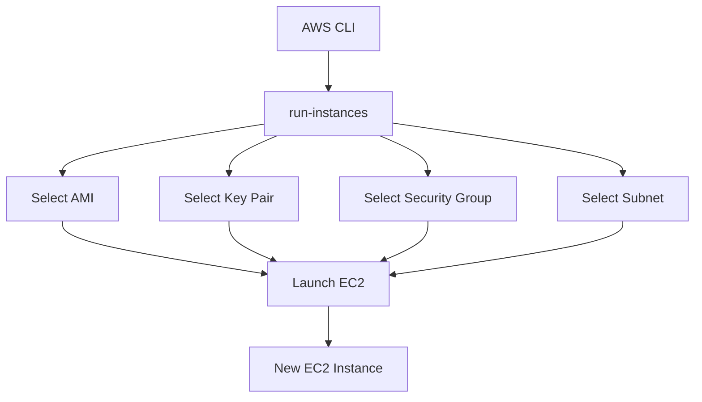
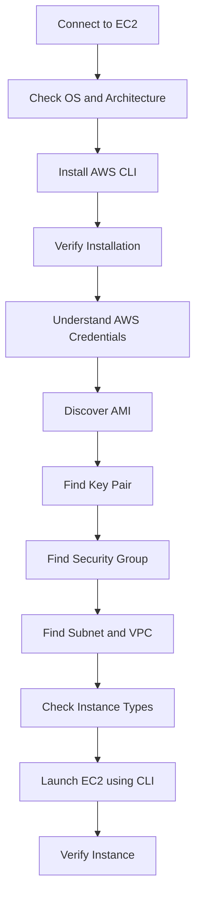

# AWS CLI and EC2 – Hands-On Practice

## From Installing AWS CLI to Launching an EC2 Instance

## 1. What I Learned

In this practice, I learned how to:

- Connect to an EC2 instance using EC2 Instance Connect.
- Check the operating system and CPU architecture.
- Install AWS CLI v2 on Ubuntu.
- Understand AWS Access Keys and IAM Roles.
- Discover AWS resources using AWS CLI.
- Check an existing EC2 configuration.
- Find Free Tier eligible instance types.
- Launch and verify a new EC2 instance using AWS CLI.

---

## 2. Connect to EC2 Instance

First, I opened my existing EC2 instance through the AWS Console.

```text
AWS Console
    |
    v
EC2
    |
    v
Instances
    |
    v
Select Instance
    |
    v
Connect
    |
    v
EC2 Instance Connect
    |
    v
Linux Terminal
```

This opened a Linux terminal inside my EC2 instance.

## 3. Check Operating System

I used the following command to check the Linux distribution.

```bash
cat /etc/os-release
```

The instance was running Ubuntu 26.04 LTS.

## 4. Check CPU Architecture

```bash
uname -m
```

Output:

```text
x86_64
```

This helped me select the correct AWS CLI installer for my system.

## 5. Install AWS CLI v2

First, I downloaded the AWS CLI package.

```bash
curl "https://awscli.amazonaws.com/awscli-exe-linux-x86_64.zip" -o "awscliv2.zip"
```

Next, I installed `unzip` because it was not available on my instance.

```bash
sudo apt install unzip
```

Then I extracted the downloaded package.

```bash
unzip awscliv2.zip
```

Finally, I installed AWS CLI.

```bash
sudo ./aws/install
```

### Installation Flow



To verify the installation:

```bash
aws --version
```

This confirmed that AWS CLI v2 was installed successfully.

---

## 6. AWS Access Key ID and Secret Access Key

I explored the AWS IAM Security Credentials section.

There are two important parts of an access key:

**Access Key ID**

- Identifies the AWS access credential.
- It is similar to a username.

**Secret Access Key**

- It is the secret part of the credential.
- It is displayed only when the access key is created.
- If it is not saved, it cannot be viewed again.

A new access key must be created if the old secret is unavailable.

### Important Security Practice

Never upload these details to GitHub:

- AWS Access Key ID
- AWS Secret Access Key
- Private keys
- Passwords and tokens

For EC2 instances, IAM Roles are generally preferred over storing long-term access keys.



---

## 7. Discover AWS Resources Using CLI

Before launching an EC2 instance, I used AWS CLI to find the required resources.

### Find an AMI

AMI stands for **Amazon Machine Image**.

It provides the image used to launch an EC2 instance.

```bash
aws ec2 describe-images \
  --owners 099720109477 \
  --filters "Name=name,Values=ubuntu/images/hvm-ssd-gp3/ubuntu-noble-24.04-amd64-server-*" \
  --query 'Images | sort_by(@, &CreationDate)[-1].[ImageId,Name]' \
  --output table
```

The AMI ID returned during my practice was:

```text
ami-052355af2a014bd2c
```

### Find Key Pairs

A Key Pair is used to authenticate when connecting to an EC2 instance.

```bash
aws ec2 describe-key-pairs \
  --query 'KeyPairs[*].KeyName' \
  --output table
```

I selected:

```text
devops-key
```

### Find Security Groups

A Security Group acts as a virtual firewall for an EC2 instance.

```bash
aws ec2 describe-security-groups \
  --query 'SecurityGroups[*].[GroupId,GroupName]' \
  --output table
```

Selected Security Group:

```text
sg-0d9f7d57cc5ab8ef7
```

### Find Subnets

A Subnet is a network segment inside a VPC.

```bash
aws ec2 describe-subnets \
  --query 'Subnets[*].[SubnetId,AvailabilityZone,VpcId]' \
  --output table
```

Selected Subnet:

```text
subnet-0e00a4ed026a21325
```

### Find VPC

The selected subnet belonged to this VPC:

```text
vpc-0c6cd2d587a5406dd
```

A VPC provides the networking environment for AWS resources.

---

## 8. Understand the AWS Network Structure

These resources work together when launching an EC2 instance.



- **VPC:** Provides the virtual network.
- **Subnet:** A network segment inside the VPC.
- **Security Group:** Controls allowed network traffic.
- **AMI:** Provides the operating system image.
- **Key Pair:** Helps authenticate access to EC2.

---

## 9. Check Existing EC2 Configuration

I wanted to find the configuration of my existing EC2 instance.

I used its private IP address:

```text
172.31.17.66
```

Command:

```bash
aws ec2 describe-instances \
  --filters "Name=private-ip-address,Values=172.31.17.66" \
  --query 'Reservations[*].Instances[*].[InstanceId,SubnetId,VpcId,SecurityGroups[*].GroupId,KeyName]' \
  --output table
```

The command returned:

| Resource | Value |
|---|---|
| Instance ID | `i-09c1cca80293a5637` |
| Subnet | `subnet-0e00a4ed026a21325` |
| VPC | `vpc-0c6cd2d587a5406dd` |
| Security Group | `sg-0d9f7d57cc5ab8ef7` |
| Key Pair | `devops-key` |

This helped me find the existing EC2 configuration without checking each resource manually.

---

## 10. Check Free Tier Eligible Instance Types

Initially, I tried to launch an instance using `t2.micro`.

AWS returned an error saying that the selected instance type was not eligible for Free Tier under my account's current rules.

Instead of guessing, I checked the eligible instance types.

```bash
aws ec2 describe-instance-types \
  --filters "Name=free-tier-eligible,Values=true" \
  --query 'InstanceTypes[*].InstanceType' \
  --output table
```

I selected:

```text
t3.micro
```

This was a useful troubleshooting experience. I learned to check AWS resource information instead of guessing.

---

## 11. Launch EC2 Using AWS CLI

After discovering the required resources, I used the `run-instances` command to launch a new EC2 instance.

### Configuration

| Resource | Selected Value |
|---|---|
| AMI | `ami-052355af2a014bd2c` |
| Instance Type | `t3.micro` |
| Key Pair | `devops-key` |
| Security Group | `sg-0d9f7d57cc5ab8ef7` |
| Subnet | `subnet-0e00a4ed026a21325` |

### Command

```bash
aws ec2 run-instances \
  --image-id ami-052355af2a014bd2c \
  --count 1 \
  --instance-type t3.micro \
  --key-name devops-key \
  --security-group-ids sg-0d9f7d57cc5ab8ef7 \
  --subnet-id subnet-0e00a4ed026a21325
```

### EC2 Launch Workflow



---

## 12. Verify the New EC2 Instance

After launching the instance, I checked its details.

The new instance returned these details:

| Detail | Value |
|---|---|
| Instance ID | `i-0b3d482baeb01c4f6` |
| State | `running` |
| Instance Type | `t3.micro` |
| Architecture | `x86_64` |
| Public IP | `54.242.200.251` |
| Private IP | `172.31.23.87` |
| Key Pair | `devops-key` |

To verify the instance, I used:

```bash
aws ec2 describe-instances \
  --filters "Name=private-ip-address,Values=172.31.23.87" \
  --query 'Reservations[*].Instances[*].[InstanceId,State.Name,PublicIpAddress,PrivateIpAddress]' \
  --output table
```

The output confirmed that the instance was running.

I successfully launched and verified an EC2 instance without using the EC2 Launch Wizard.

---

## 13. Important AWS CLI Commands

These are the commands I practised during this hands-on session.

| Command | Purpose |
|---|---|
| `aws --version` | Check AWS CLI version |
| `aws ec2 describe-images` | Find AMIs |
| `aws ec2 describe-key-pairs` | List Key Pairs |
| `aws ec2 describe-security-groups` | List Security Groups |
| `aws ec2 describe-subnets` | List Subnets |
| `aws ec2 describe-instances` | Get EC2 details |
| `aws ec2 describe-instance-types` | Check instance types |
| `aws ec2 run-instances` | Launch EC2 |

### Important CLI Options

| Option | Purpose |
|---|---|
| `--image-id` | Select an AMI |
| `--count` | Number of instances |
| `--instance-type` | Select EC2 size |
| `--key-name` | Select Key Pair |
| `--security-group-ids` | Select Security Group |
| `--subnet-id` | Select Subnet |
| `--filters` | Filter AWS resources |
| `--query` | Filter or format output |
| `--output table` | Display output as a table |

---

## 14. Complete Workflow



---

## 15. Key Takeaways

- AWS CLI allows us to manage AWS resources from the terminal.
- An AMI provides the image used to launch an EC2 instance.
- A Key Pair is used for EC2 authentication.
- A Security Group controls network traffic.
- A Subnet is a network segment inside a VPC.
- A VPC provides the virtual networking environment.
- Instance types determine the compute resources available to EC2.
- `describe` commands help us discover AWS resources.
- `run-instances` allows us to launch EC2 through the command line.
- IAM Roles are generally preferred for providing AWS permissions to EC2.

## 16. Security Reminder

Never commit sensitive information to GitHub.

Do not upload:

- AWS Access Keys
- Secret Access Keys
- `.pem` private keys
- Credentials files
- Passwords and API tokens
- `.env` files containing secrets

Prefer IAM Roles, environment variables, AWS Secrets Manager or Systems Manager Parameter Store depending on the use case.

---

## 17. Important Note

The AMI, Security Group, Subnet, VPC and instance IDs used in this practice belong to my AWS environment.

These values can change between accounts and regions. Always discover the required resource IDs again before using them in another project.

## Final Result

I installed AWS CLI v2, discovered AWS resources and launched a new EC2 instance using only AWS CLI.

**My learning flow:**

```text
AWS CLI Installation
        |
        v
AWS Resource Discovery
        |
        v
EC2 Configuration
        |
        v
Launch EC2 using CLI
        |
        v
Verify EC2 Instance
```

**Learn → Practice → Troubleshoot → Automate**
