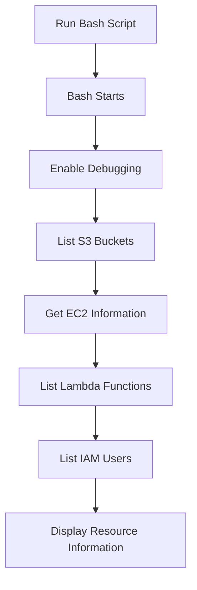
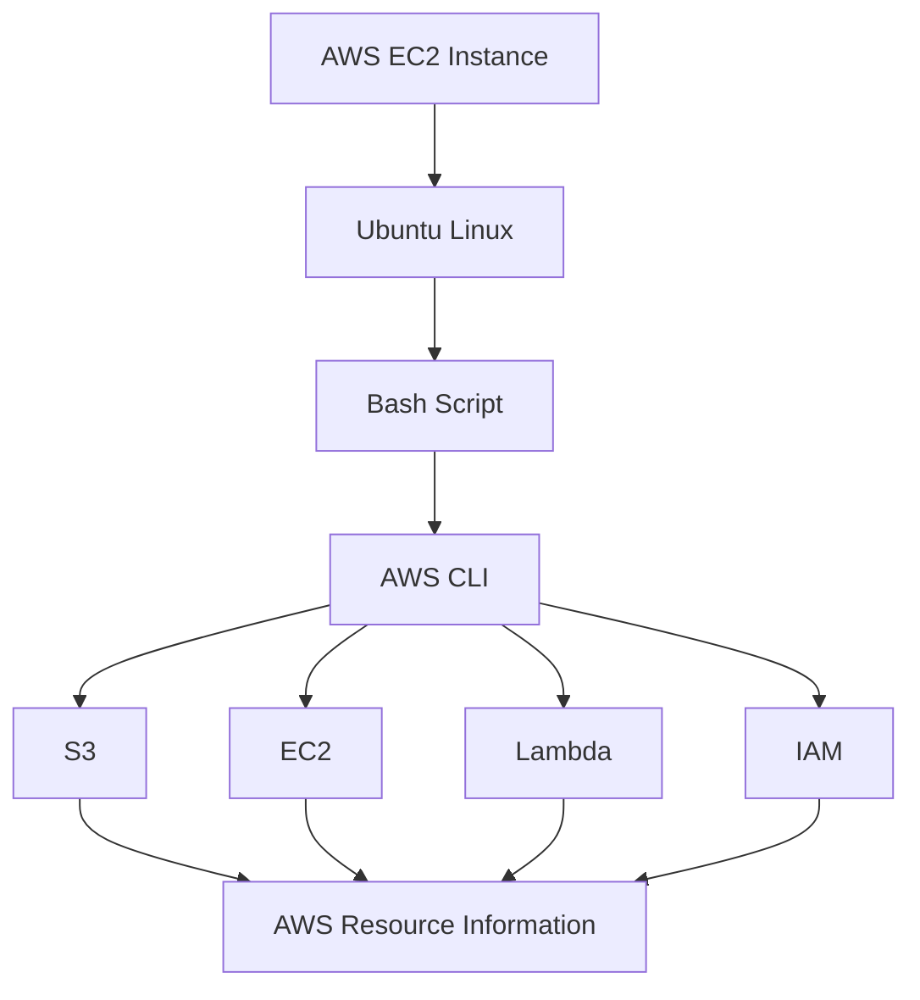
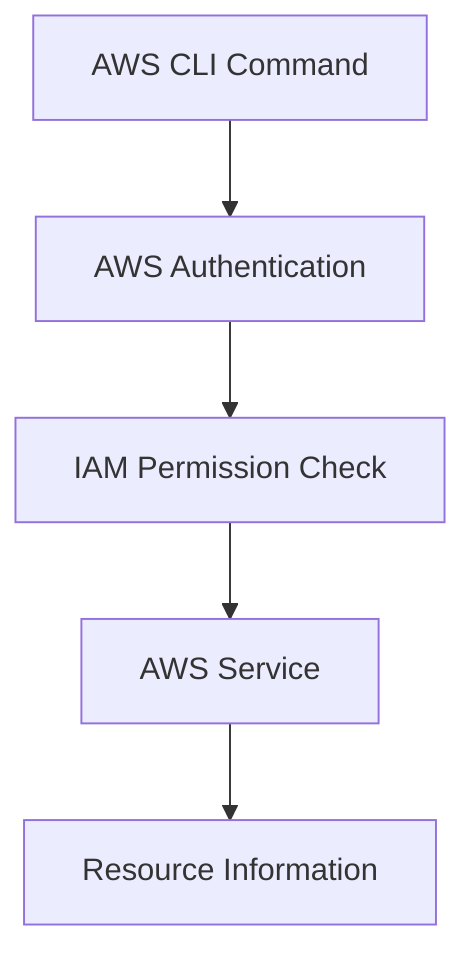

# AWS Resource Tracker Using Shell Scripting

## 1. Project Overview

In this project, I built a simple **AWS Resource Tracker** using Bash Shell Scripting and AWS CLI.

The main goal was to automate AWS CLI commands instead of running them manually one by one.

The script collects information about:

- S3 Buckets
- EC2 Instances
- Lambda Functions
- IAM Users

## 2. Environment and Tools

I performed this project inside an AWS EC2 instance.

| Tool | Purpose |
|---|---|
| AWS EC2 | Cloud environment |
| Ubuntu Linux | Operating system |
| AWS CLI | Communicate with AWS |
| Bash | Shell scripting |
| Vim | Edit the script |
| IAM | Manage AWS permissions |
| S3 | Object storage |
| Lambda | Serverless functions |

**Environment:**
- OS: Ubuntu 26.04 LTS
- Architecture: x86_64
- Region: us-east-1

## 3. Configure AWS CLI

Before executing AWS CLI commands, we need to configure authentication.

```bash
aws configure
```

It asks for:

```text
AWS Access Key ID
AWS Secret Access Key
Default region name
Default output format
```

For this project, the region was:

```text
us-east-1
```

To check the AWS CLI installation:

```bash
aws --version
```

**Security note:** Never commit AWS credentials to GitHub. For EC2 workloads, prefer an IAM Role instead of storing long-term access keys on the server.

## 4. Create the Bash Script

I created a file named:

```bash
vim aws_resource_tracker.sh
```

The script contains Bash instructions and AWS CLI commands.

### Bash Shebang

Every Bash script starts with:

```bash
#!/bin/bash
```

This tells Linux to execute the script using Bash.

I also added comments to describe the script.

```bash
#!/bin/bash

# Author: Yuvraj
# Date: 16-08-2026

# This script will report AWS resource usage
```

## 5. Enable Bash Debugging

I used:

```bash
set -x
```

This displays each command before Bash executes it.

For example:

```text
+ echo "Print list of s3 buckets"
Print list of s3 buckets
+ aws s3 ls
```

This is useful when understanding and troubleshooting script execution.

## 6. AWS Resource Commands

I added four AWS CLI commands to the script.

### List S3 Buckets

```bash
echo "Print list of s3 buckets"
aws s3 ls
```

This lists the S3 buckets accessible to the configured AWS identity.

### List EC2 Instances

```bash
echo "Print list of EC2 Instances"
aws ec2 describe-instances
```

This retrieves EC2 information such as:

- Instance ID
- Instance state
- Instance type
- Public and private IP addresses
- Security Groups
- VPC and Subnet

### List Lambda Functions

```bash
echo "Print list of lambda functions"
aws lambda list-functions
```

This lists Lambda functions available in the configured AWS region.

### List IAM Users

```bash
echo "Print list of IAM users"
aws iam list-users
```

This retrieves IAM user information accessible to the configured AWS identity.

## 7. Complete Resource Tracker Script

This is the complete script I created.

```bash
#!/bin/bash

# Author: Yuvraj
# Date: 16-08-2026

# This script will report AWS resource usage

set -x

# List S3 buckets
echo "Print list of s3 buckets"
aws s3 ls

# List EC2 Instances
echo "Print list of EC2 Instances"
aws ec2 describe-instances

# List Lambda functions
echo "Print list of lambda functions"
aws lambda list-functions

# List IAM users
echo "Print list of IAM users"
aws iam list-users
```

## 8. Give Execute Permission

Initially, the script may not have permission to execute.

I used:

```bash
chmod 777 aws_resource_tracker.sh
```

This changes the file permissions.

However, `777` gives everyone read, write and execute permissions. A more suitable option for a normal script is:

```bash
chmod +x aws_resource_tracker.sh
```

Or:

```bash
chmod 755 aws_resource_tracker.sh
```

## 9. Execute the Script

After giving execute permission, I ran:

```bash
./aws_resource_tracker.sh
```

The `./` means that the file is being executed from the current directory.

### Execution Flow



## 10. Project Architecture

The Bash script acts as an automation layer between Linux and AWS services.



## 11. AWS Services Used

| AWS Service | CLI Command | Purpose |
|---|---|---|
| S3 | `aws s3 ls` | List S3 buckets |
| EC2 | `aws ec2 describe-instances` | Retrieve EC2 information |
| Lambda | `aws lambda list-functions` | List Lambda functions |
| IAM | `aws iam list-users` | List IAM users |

## 12. IAM Permissions

AWS CLI commands work based on the permissions of the configured AWS identity.

For example:

- `aws s3 ls` requires appropriate S3 permissions.
- `aws ec2 describe-instances` requires EC2 describe permissions.
- `aws lambda list-functions` requires Lambda list permissions.
- `aws iam list-users` requires IAM list permissions.

The basic flow is:



## 13. Manual vs Automated Approach

**Manual approach**

We need to execute every command separately.

```bash
aws s3 ls
aws ec2 describe-instances
aws lambda list-functions
aws iam list-users
```

**Automated approach**

We only need to execute:

```bash
./aws_resource_tracker.sh
```

The script runs all the commands automatically.

This is the basic idea behind automation using shell scripting.

## 14. Project Structure

```text
AWS-Resource-Tracker/
│
├── aws_resource_tracker.sh
│
└── README.md
```

- `aws_resource_tracker.sh` contains the automation script.
- `README.md` contains project documentation.

## 15. Important Commands

| Command | Purpose |
|---|---|
| `aws --version` | Check AWS CLI version |
| `aws configure` | Configure AWS CLI |
| `aws s3 ls` | List S3 buckets |
| `aws ec2 describe-instances` | Get EC2 information |
| `aws lambda list-functions` | List Lambda functions |
| `aws iam list-users` | List IAM users |
| `vim filename.sh` | Create or edit a script |
| `chmod +x filename.sh` | Give execute permission |
| `./filename.sh` | Execute the script |
| `set -x` | Enable command tracing |

## 16. What I Learned

Through this project, I practised:

- Creating and executing Bash scripts.
- Using AWS CLI from an EC2 instance.
- Retrieving information from multiple AWS services.
- Understanding Linux file permissions.
- Using `set -x` for debugging.
- Understanding IAM permissions.
- Automating repetitive AWS CLI commands.

## 17. Future Improvements

This is a basic version of an AWS Resource Tracker. It can be improved by adding:

- Resource counts
- EC2 running and stopped status
- Error handling
- Logging
- AWS region selection
- Cron job scheduling
- CloudWatch integration
- Email notifications

## Final Takeaway

The main thing I learned from this project is that we can combine Linux, Bash and AWS CLI to automate repetitive cloud operations.

Instead of running multiple commands manually, a single Bash script can execute them together.

**Linux + Bash + AWS CLI + IAM = Cloud Automation**
