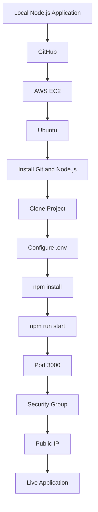
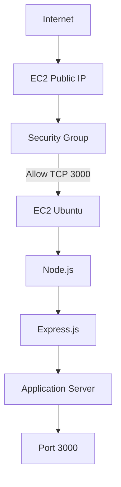
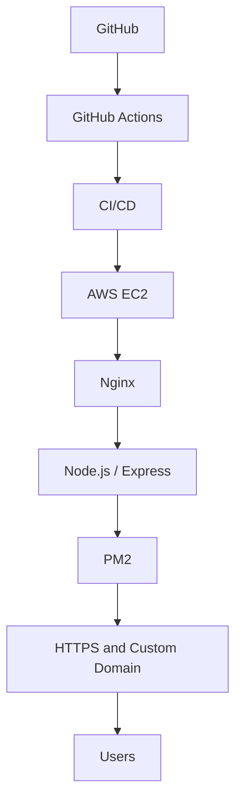
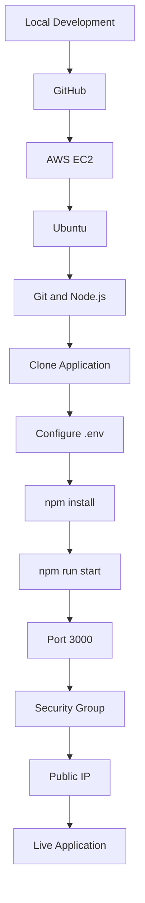

# Deploying a Node.js Application on AWS EC2

## 1. Project Overview

In this project, I deployed a Node.js application on an AWS EC2 Ubuntu server and accessed it through the EC2 public IP address.

The application runs on port `3000`.

### Deployment Flow



## 2. Technologies Used

| Technology | Purpose |
|---|---|
| AWS EC2 | Cloud server |
| Ubuntu | Operating system |
| Node.js | JavaScript runtime |
| npm | Package management |
| Express.js | Backend framework |
| Git | Version control |
| GitHub | Source code hosting |
| Security Group | Network traffic control |
| `.env` | Environment configuration |
| Stripe | Payment integration |

## 3. Test the Project Locally

Before deploying the application, I checked the project locally.

### Clone the Project

```bash
git clone https://github.com/verma-kunal/AWS-Session.git
```

Move into the project directory:

```bash
cd AWS-Session
```

### Configure Environment Variables

Create a `.env` file in the project directory.

```bash
vim .env
```

Add the required configuration:

```env
DOMAIN=""
PORT=3000
STATIC_DIR="./client"

PUBLISHABLE_KEY=""
SECRET_KEY=""
```

| Variable | Purpose |
|---|---|
| `DOMAIN` | Application domain or IP |
| `PORT` | Server port |
| `STATIC_DIR` | Frontend files location |
| `PUBLISHABLE_KEY` | Stripe publishable key |
| `SECRET_KEY` | Stripe secret key |

Never expose the Stripe secret key publicly.

### Install Dependencies

```bash
npm install
```

### Start the Application

```bash
npm run start
```

Expected output:

```text
Server listening on port: 3000
```

## 4. Create an AWS EC2 Instance

Next, I created an EC2 instance to host the application.

Go to:

```text
AWS Console
    |
    v
EC2
    |
    v
Instances
    |
    v
Launch Instance
```

### Configuration

| Setting | Value |
|---|---|
| OS Image | Ubuntu |
| Instance Type | t2.micro |
| Key Pair | Create a new key pair |
| Key File | `.pem` |

Download the `.pem` file and keep it secure.

## 5. Connect to EC2 Using SSH

After launching the instance, I connected to it using SSH.

```bash
ssh -i instance.pem ubuntu@<PUBLIC_IP_ADDRESS>
```

The default Ubuntu username is:

```text
ubuntu
```

After connecting successfully, the terminal looks similar to:

```text
ubuntu@ip-172-31-31-76:~$
```

This means I am connected to the remote EC2 Ubuntu server.

## 6. Configure Ubuntu

Once connected, I prepared the server.

### Update Package Lists

```bash
sudo apt update
```

### Install Git

```bash
sudo apt install git -y
```

Verify:

```bash
git --version
```

### Install Node.js and npm

```bash
sudo apt install nodejs npm -y
```

Verify Node.js:

```bash
node -v
```

Verify npm:

```bash
npm -v
```

During this deployment, the Node.js version was:

```text
v22.22.1
```

## 7. Clone the Project on EC2

Now I cloned the application from GitHub directly into the EC2 instance.

```bash
git clone https://github.com/verma-kunal/AWS-Session.git
```

Move into the project:

```bash
cd AWS-Session
```

Check the files:

```bash
ls
```

## 8. Configure the `.env` File on EC2

The application requires environment variables to run.

Create the file:

```bash
vim .env
```

Press `i` to enter insert mode and add:

```env
DOMAIN=""
PORT=3000
STATIC_DIR="./client"

PUBLISHABLE_KEY="YOUR_STRIPE_PUBLISHABLE_KEY"
SECRET_KEY="YOUR_STRIPE_SECRET_KEY"
```

Save and exit Vim:

```text
ESC
:wq
ENTER
```

Check the file:

```bash
ls -la
```

The `.env` file should be present.

**Important:** Keep `.env` private. Never upload secret keys to GitHub.

## 9. Install Project Dependencies

Inside the project directory, run:

```bash
npm install
```

This installs the packages required by the application.

## 10. Start the Node.js Application

Run:

```bash
npm run start
```

Expected output:

```text
> stripe-integration@1.0.0 start
> node server.js

Server listening on port: 3000
```

The application is now running on the EC2 server.

## 11. Configure AWS Security Group

The application is running on port `3000`. However, we also need to allow incoming traffic through the EC2 Security Group.

Go to:

```text
AWS Console
    |
    v
EC2
    |
    v
Instances
    |
    v
Select Instance
    |
    v
Security
    |
    v
Security Groups
    |
    v
Inbound Rules
    |
    v
Edit Inbound Rules
```

Add this rule for testing:

| Type | Port | Source |
|---|---:|---|
| Custom TCP | 3000 | `0.0.0.0/0` |

Save the rule.

The Security Group controls which incoming traffic can reach the EC2 instance.

**Security note:** `0.0.0.0/0` allows access from any IPv4 address. For a real deployment, restrict access to trusted IP addresses or use a properly secured web architecture.

## 12. Access the Application

After configuring the Security Group, find the EC2 Public IPv4 address.

Example:

```text
18.207.96.65
```

Since the application runs on port `3000`, open:

```text
http://18.207.96.65:3000
```

Or use:

```text
http://<PUBLIC_IPV4>:3000
```

The application should now be accessible through the browser.

## 13. Deployment Architecture



## 14. Troubleshooting

### Error: Unable to Locate Package npm

Update the package lists and try installing again.

```bash
sudo apt update
sudo apt install nodejs npm -y
```

Verify:

```bash
node -v
npm -v
```

### Error: Cannot Find Module 'express'

Install the project dependencies:

```bash
npm install
```

If Express is missing from the project dependencies:

```bash
npm install express
```

Then start the application again:

```bash
npm run start
```

### Error: `paths[1]` Argument Must Be a String

This happened because the application expected a required environment variable or configuration value.

Creating and configuring the `.env` file resolved the problem.

### Website Cannot Be Reached

First, check whether the application is running:

```bash
npm run start
```

Check whether port `3000` is listening:

```bash
sudo ss -tulpn | grep 3000
```

Then verify the Security Group inbound rule:

```text
Type: Custom TCP
Port: 3000
Source: 0.0.0.0/0
```

Finally, access the application using the EC2 Public IPv4 address:

```text
http://PUBLIC_IP:3000
```

Do not use the private IP address such as `172.31.x.x` from an external browser.

## 15. Important Commands

```bash
# Update Ubuntu packages
sudo apt update

# Install Git
sudo apt install git -y

# Install Node.js and npm
sudo apt install nodejs npm -y

# Check Node.js version
node -v

# Check npm version
npm -v

# Clone the project
git clone https://github.com/verma-kunal/AWS-Session.git

# Enter the project directory
cd AWS-Session

# Create environment file
vim .env

# Install dependencies
npm install

# Start the application
npm run start

# Check port 3000
sudo ss -tulpn | grep 3000
```

## 16. Security Notes

Never commit sensitive information to GitHub.

Keep these files and values private:

- Stripe secret key
- AWS Access Keys
- SSH private keys
- `.env` files
- `.pem` files

Add the following to `.gitignore`:

```text
.env
instance.pem
```

Never upload private SSH keys or secret credentials to public repositories.

## 17. What I Learned

Through this project, I learned:

| Concept | What I Practised |
|---|---|
| AWS EC2 | Creating a cloud server |
| Ubuntu | Configuring a Linux server |
| SSH | Connecting to EC2 remotely |
| Git | Cloning source code |
| Node.js | Running applications on a server |
| npm | Installing dependencies |
| Express.js | Running a backend application |
| `.env` | Managing application configuration |
| Security Groups | Allowing inbound traffic |
| Public IP | Accessing an application over the internet |
| Deployment | Moving an application from local development to AWS |

## 18. Future Improvements

This was a basic EC2 deployment. It can be improved with:

- GitHub Actions for CI/CD
- PM2 for process management
- Nginx as a reverse proxy
- HTTPS using SSL/TLS
- Custom domain
- Monitoring and logging
- Docker containerization
- Kubernetes deployment
- AWS Load Balancer
- Auto Scaling

### Future Deployment Architecture



## Final Summary

In this project, I deployed a Node.js application on AWS EC2.

I cloned the source code from GitHub, configured Ubuntu, installed Git and Node.js, created the `.env` file, installed dependencies and started the application.

Finally, I configured the EC2 Security Group to allow traffic on port `3000` and accessed the application using the public IP address.

### Complete Deployment Flow



**Local Machine → GitHub → AWS EC2 → Ubuntu → Node.js → Live Application**
