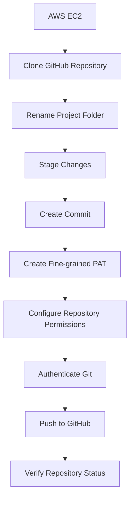
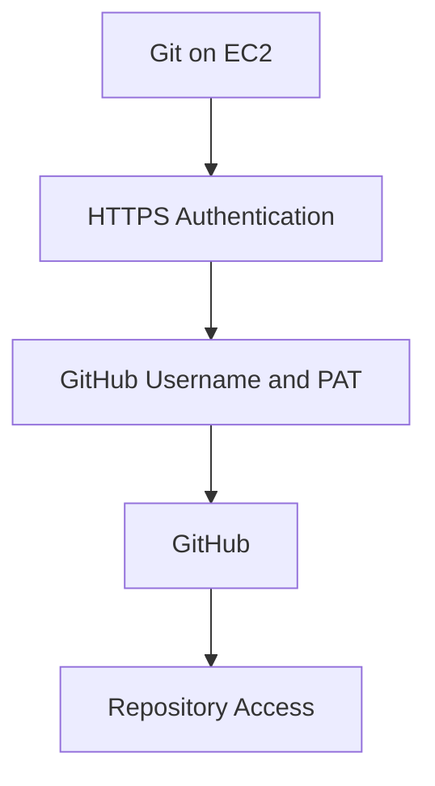
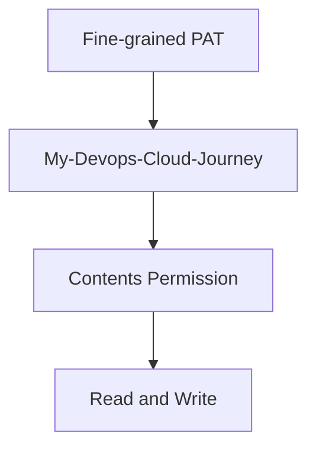
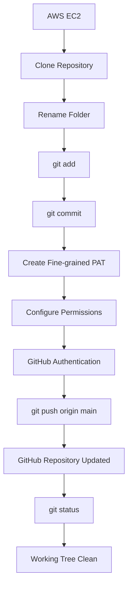

# GitHub Personal Access Token Authentication from AWS EC2

## 1. Overview

In this practical, I used a **GitHub Fine-grained Personal Access Token (PAT)** to authenticate GitHub from an AWS EC2 Ubuntu instance.

I also renamed a project folder, committed the changes and pushed them to GitHub.

### Complete Workflow



## 2. Environment

| Component | Details |
|---|---|
| Cloud Platform | AWS |
| Compute Service | EC2 |
| Operating System | Ubuntu |
| Version Control | Git |
| Remote Repository | GitHub |
| Authentication | Fine-grained PAT |
| Branch | `main` |

## 3. Clone the GitHub Repository

First, I moved to the home directory.

```bash
cd ~
```

Clone the repository:

```bash
git clone https://github.com/Yuvii2102/My-Devops-Cloud-Journey.git
```

Enter the repository:

```bash
cd My-Devops-Cloud-Journey
```

Check the files:

```bash
ls
```

Check the Git status:

```bash
git status
```

The repository is now available locally on EC2.

## 4. Rename the Project Folder

The original folder name was:

```text
What-I-Learnt
```

I wanted to rename it to:

```text
DevOps-Labs-and-Projects
```

I used Git's `mv` command:

```bash
git mv What-I-Learnt DevOps-Labs-and-Projects
```

Check the updated directory:

```bash
ls
```

The repository now contains:

```text
My-Devops-Cloud-Journey/
│
├── My-Journey/
├── DevOps-Labs-and-Projects/
└── README.md
```

Using `git mv` allows Git to track the rename.

## 5. Check and Stage Changes

Check the changes:

```bash
git status
```

Git detects the renamed files.

Next, stage all changes:

```bash
git add .
```

This prepares the changes for committing.

## 6. Create a Git Commit

I created a commit describing the folder rename.

```bash
git commit -m "Rename What-I-Learnt to DevOps-Labs-and-Projects"
```

The commit is now saved in the local Git repository.

However, the changes are not yet available on GitHub.

## 7. Attempt to Push Changes

I tried pushing the changes using:

```bash
git push origin main
```

Git asked for a username and password.

The authentication failed because GitHub does not accept normal account passwords for Git operations over HTTPS.

Example error:

```text
remote: Invalid username or token.
fatal: Authentication failed
```

This is where a Personal Access Token is required.

## 8. What Is a GitHub Personal Access Token?

A **Personal Access Token (PAT)** is a credential used to authenticate GitHub operations.

For Git operations over HTTPS, it can be used instead of a normal account password.



A Fine-grained PAT allows us to restrict access to specific repositories and permissions.

## 9. Create a Fine-grained PAT

Go to GitHub:

```text
GitHub
   |
   v
Settings
   |
   v
Developer Settings
   |
   v
Personal Access Tokens
   |
   v
Fine-grained Tokens
   |
   v
Generate New Token
```

## 10. Configure the PAT

### Token Name

I used:

```text
EC2-GitHub-Access
```

### Description

```text
Git access for pushing DevOps Cloud Journey from AWS EC2
```

### Expiration

Choose an appropriate expiration period.

For this practical:

```text
90 days
```

An expiration date limits how long the token remains valid.

## 11. Configure Repository Access

GitHub provides different repository access options.

Instead of selecting all repositories, I selected:

```text
Only select repositories
```

Then I selected:

```text
My-Devops-Cloud-Journey
```

This follows the principle of least privilege.

## 12. Configure Repository Permissions

Under Repository Permissions, I configured:

```text
Contents → Read and write
```

This permission allows Git to read and update repository contents.



Only grant the permissions required for the task.

## 13. Generate the Token

After configuring the repository access and permissions, click:

```text
Generate token
```

GitHub generates a token.

Copy it immediately and store it securely because the token cannot simply be viewed again later.

## 14. Authenticate Git Using PAT

Return to the EC2 terminal and run:

```bash
git push origin main
```

Git asks for a username:

```text
Username for 'https://github.com':
```

Enter your GitHub username:

```text
Yuvii2102
```

Next, Git asks for a password:

```text
Password for 'https://Yuvii2102@github.com':
```

Paste the GitHub PAT instead of your account password.

Nothing will appear in the terminal while entering the token. This is normal.

Press Enter to continue.

GitHub verifies the token and its permissions.

## 15. Successful Git Push

After successful authentication, Git uploads the commit to GitHub.

Typical output:

```text
Enumerating objects...
Counting objects...
Compressing objects...
Writing objects...
```

The branch update looks similar to:

```text
main -> main
```

This confirms that the changes were pushed successfully.

## 16. Verify Repository Status

After pushing, I checked the repository:

```bash
git status
```

Expected output:

```text
On branch main
Your branch is up to date with 'origin/main'.

nothing to commit, working tree clean
```

This confirms that the local repository is synchronized with GitHub.

To check the remote repository:

```bash
git remote -v
```

Expected output:

```text
origin  https://github.com/Yuvii2102/My-Devops-Cloud-Journey.git (fetch)
origin  https://github.com/Yuvii2102/My-Devops-Cloud-Journey.git (push)
```

## 17. Important Git Commands

| Command | Purpose |
|---|---|
| `git clone` | Clone a repository |
| `cd` | Enter a directory |
| `git mv` | Rename tracked files or folders |
| `git status` | Check repository status |
| `git add .` | Stage changes |
| `git commit` | Save changes locally |
| `git push origin main` | Push changes to GitHub |
| `git remote -v` | Check remote repository |

## 18. Complete Command Sequence

These are the commands used during this practical.

```bash
# Move to home directory
cd ~

# Clone repository
git clone https://github.com/Yuvii2102/My-Devops-Cloud-Journey.git

# Enter repository
cd My-Devops-Cloud-Journey

# Check files and status
ls
git status

# Rename project folder
git mv What-I-Learnt DevOps-Labs-and-Projects

# Stage changes
git add .

# Create commit
git commit -m "Rename What-I-Learnt to DevOps-Labs-and-Projects"

# Push changes
git push origin main

# Verify repository
git status
git remote -v
```

During the push operation, GitHub authentication is performed using the Fine-grained PAT.

## 19. Troubleshooting

### Authentication Failed

If you see:

```text
remote: Invalid username or token.
fatal: Authentication failed
```

Check the following:

- GitHub username is correct.
- PAT is valid and has not expired.
- Correct repository is selected.
- `Contents` permission is set to `Read and write`.
- PAT is used instead of the normal GitHub password.
- Token has not been revoked.

### PAT Expired

Create a new Fine-grained PAT, select the required repository and configure the necessary permissions.

Then use the new token during authentication.

### PAT Accidentally Exposed

If a token is exposed:

1. Revoke the exposed token.
2. Generate a new token.
3. Update authentication.
4. Check whether the token was committed.
5. Remove exposed credentials from Git history if necessary.

Never continue using an exposed token.

## 20. Security and Least Privilege

A PAT should be treated like a password.

Never:

- Share the token with anyone.
- Upload it to GitHub.
- Put it inside source code or README files.
- Include it in screenshots.
- Commit it to Git.
- Store it in a public `.env` file.

Always:

- Use minimum required permissions.
- Restrict access to required repositories.
- Set an expiration date.
- Store the token securely.
- Revoke it if exposed.

Instead of granting access to all repositories, I restricted the token to `My-Devops-Cloud-Journey` with `Contents → Read and write`.

This reduces the possible impact if the token is compromised.

## 21. What I Learned

Through this practical, I learned:

- How to clone a GitHub repository on EC2.
- How to rename folders using `git mv`.
- How to stage and commit changes.
- How GitHub HTTPS authentication works.
- Why normal GitHub passwords cannot be used for Git HTTPS authentication.
- What a Personal Access Token is.
- How to create a Fine-grained PAT.
- How to restrict a token to a specific repository.
- How to configure repository permissions.
- How to push changes from EC2 to GitHub.
- How to verify repository synchronization.
- Why the principle of least privilege is important.

## Final Summary

In this practical, I renamed a project folder on my AWS EC2 instance, committed the changes and pushed them to GitHub using a Fine-grained Personal Access Token.

The main thing I learned was how to authenticate GitHub securely from a remote Linux server.

### Complete Workflow



**AWS EC2 → Git → GitHub → PAT Authentication → Secure Push**
