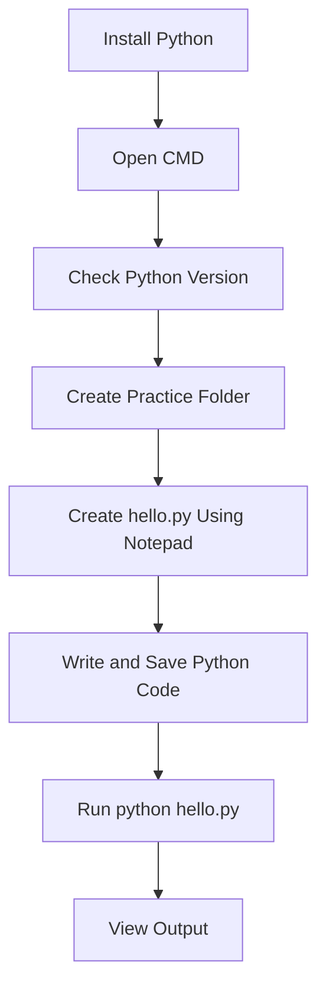

# Run Python Code Using Command Prompt (CMD)

This guide explains how to install Python on Windows and run a Python program using Command Prompt without using VS Code.

## Step 1: Install Python

1. Open your browser.
2. Visit the official [Python website](https://www.python.org/downloads/windows/).
3. Download the latest Python version for Windows.
4. Open the downloaded installer.
5. **Important:** Select **Add Python to PATH**.
6. Click **Install Now** and wait for the installation to finish.

Python is now installed on your system.

## Step 2: Open Command Prompt

1. Press `Windows + R`.
2. Type the following command:

```cmd
cmd
```

3. Press Enter.

Command Prompt will open. You can enter commands here.

Example:

```text
C:\Users\YourName>
```

## Step 3: Check Python Installation

Run the following command:

```cmd
python --version
```

Example output:

```text
Python 3.14.0
```

Your version may be different.

If the command doesn't work, try:

```cmd
py --version
```

If neither command works, check your Python installation and PATH settings.

## Step 4: Create a Folder for Python Programs

Create a folder to store your Python files.

```cmd
mkdir Python-Practice
```

Enter the folder:

```cmd
cd Python-Practice
```

Your terminal should now look like this:

```text
C:\Users\YourName\Python-Practice>
```

## Step 5: Create Your First Python File

We will use Notepad to write our Python code.

Open Notepad from CMD:

```cmd
notepad hello.py
```

Notepad will open in a separate window.

Write the following code:

```python
print("Hello, World!")
print("I am learning Python!")
```

Save the file using **File → Save** and close Notepad.

Your Python file is now saved as `hello.py`.

## Step 6: Run Your Python Program

Make sure you are inside the `Python-Practice` folder.

Run the following command:

```cmd
python hello.py
```

Expected output:

```text
Hello, World!
I am learning Python!
```

If the `python` command doesn't work but `py --version` works, use:

```cmd
py hello.py
```

## How the Process Works



## What I Learned

- How to install Python on Windows.
- How to open and use Command Prompt.
- How to check the Python version.
- How to create folders using CMD.
- How to create Python files using Notepad.
- How to execute Python programs from the terminal.
